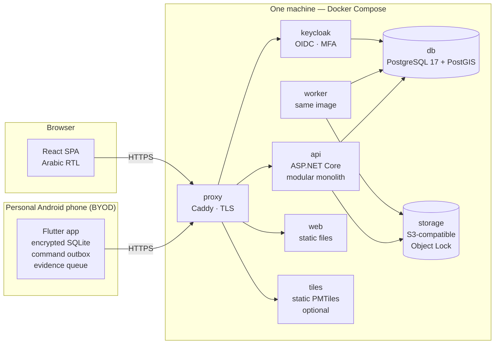

# 01 — Architecture, Docker Compose Topology, Repository, API Boundaries

## 1.1 Architecture (item 1)



### Principles

1. **One backend codebase, two processes.** `api` serves HTTP. `worker` runs background jobs: outbox dispatch, evidence verification and thumbnails, rules, daily audit checkpoint. Both are the same Docker image with a different entrypoint.
2. **PostgreSQL is the only stateful service for business data.** It also holds the outbox and job tables. There is no Redis and no message broker.
3. **Keycloak handles identity only.** It does login, passwords, MFA and sessions. **Authorization lives in our backend** and is evaluated from our database on every request, never from token claims.
4. **The device-trust layer is ours.** Device registration, device status, offline grants and sync acceptance are implemented in the backend (`Access` + `Sync` modules). This is what BYOD revocation depends on, so it must not be delegated.
5. **Evidence bytes never pass through the database.** In the pilot, uploads are streamed **through the API**: the API computes SHA-256 while it streams into a quarantine bucket, and the worker then promotes the file to the write-once bucket. This is a lean simplification of the long-term presigned-URL design. It avoids CORS and presigned-host issues on a LAN setup, and the server hash is computed on the exact bytes received.

### Backend internal structure

Modular monolith. Each module is one C# project with this internal layout:

```
Module/
  Domain/          entities, value objects, state machines   (no EF, no HTTP)
  Application/     command handlers, queries, policies       (uses Domain + Contracts of other modules)
  Infrastructure/  EF Core mappings, repositories            (schema = module name)
  Api/             endpoint definitions (Minimal APIs)
  Contracts/       public interfaces/DTOs other modules may use
```

| Module | Owns (DB schema) |
|---|---|
| `Access` | organization config, users, role assignments, devices, offline grants, policy settings |
| `Assets` | street lights, asset versions, registrations, field checks, tags, tag batches |
| `Faults` | fault reports, confirmations |
| `WorkOrders` | work orders, events, arrivals, diagnosis, checklist templates and results, submissions, reviews |
| `Evidence` | evidence metadata, storage keys, verification state |
| `Inventory` | items, costs, locations, movements, balances, issues, returns, core-return obligations |
| `Audit` | audit events, checkpoints |
| `Rules` | rule settings, flags, recommendations |
| `Sync` | received commands, results, quarantine, clock samples |

**Command pipeline.** Web REST commands and mobile sync commands both go through the same pipeline:

```
CommandEnvelope {command_id, type, payload, actor, device_id?, device_time?, elapsed_ms?, boot_id?, grant_id?}
  → idempotency check (command_id)
  → authentication already done; load actor + device status from DB
  → authorization: permission + scope + record-level policy (maker≠checker, assignee, state)
  → handler: load aggregate → state-machine transition → validate guards/evidence requirements
  → persist: entity changes + domain events (outbox) + AuditEvent  — ONE transaction
  → result {APPLIED | DUPLICATE | REJECTED(code) | QUARANTINED(code)}
```

## 1.2 Docker Compose topology (item 9)

> **DEMO 1 topology is smaller** (see 11 §11.2 M0): `db`, `keycloak`, `api` (with background work as an in-process hosted service), `web`, and a volume for the local object store. The phone connects through `adb reverse` to `localhost`, with no proxy or TLS. The full topology below (proxy, separate worker, S3 with Object Lock, tiles) is completed in M8 and is required before a real field pilot.

| Service | Image (indicative) | Purpose | Exposed |
|---|---|---|---|
| `proxy` | `caddy` | TLS termination (internal CA for dev), routing, basic rate limit, request size limits | `443` (and `80` → redirect) |
| `api` | built from `backend/` | HTTP API | internal only |
| `worker` | same image, `--worker` | background jobs | none |
| `db` | `postgis/postgis:17-*` | business DB (`mfop`) + Keycloak DB (`keycloak`), separate databases and roles | `127.0.0.1:5432` in dev only |
| `keycloak` | `quay.io/keycloak/keycloak` | OIDC provider, realm imported from `deploy/keycloak/realm-mfop.json` | via proxy `/auth` |
| `storage` | S3-compatible server with Object Lock (candidate: MinIO; **licence and image availability must be verified in M0**; alternatives: SeaweedFS, Ceph RGW) | evidence and anchors | via proxy only if needed; the API talks to it internally |
| `storage-init` | S3 CLI one-shot | creates buckets and sets Object Lock retention | none |
| `web` | built from `web/`, static files | SPA | via proxy `/` |
| `tiles` | static file server (optional profile `map`) | PMTiles basemap for the configured area | via proxy `/tiles` |

**Buckets:**

| Bucket | Object Lock | Content |
|---|---|---|
| `evidence-incoming` | no | raw uploads before verification (short retention) |
| `evidence` | **yes (compliance mode, retention configurable; dev default 1 day, pilot ≥ 5 years)** | verified originals |
| `evidence-derived` | no | re-encoded thumbnails and previews without EXIF |
| `audit-anchors` | **yes** | daily signed checkpoints |

**Local development and DEMO 1:** a `LocalFileSystemObjectStore` behind the same S3-compatible `IObjectStore` interface is the default (approved), selected with `STORAGE_MODE=local`. The production-compatible product is chosen later. The web console shows a red "LOCAL STORAGE — NOT WORM" banner in this mode, and **field-pilot configuration refuses to start in it**.

**Networking for phones in development:**
- USB: `adb reverse tcp:443 tcp:443`. The phone reaches the dev machine as `localhost`. This is the simplest option.
- LAN: the phone uses `https://<dev-hostname>`. Debug builds trust the Caddy dev CA through Android `network_security_config` `debug-overrides`. **Release builds never trust user CAs.**

**Configuration:** one `.env` (from `.env.example`, no secrets committed) plus `config/organization.json` (name, locale, time zone `Asia/Damascus`, default currency `SYP`, map center and bounds, policy defaults). Everything that is TBD for the municipality lives in configuration or seed data.

**Commands for developers:**

```
make up         # docker compose up -d (all services)
make seed       # synthetic demo data through the API (not SQL inserts)
make demo-reset # wipe dev volumes and re-seed
make verify-audit  # run chain verifier against the dev DB
```

Resource target: the whole stack runs in **≤ 6 GB RAM** on a developer laptop.

## 1.3 Repository structure (item 10)

```
/
├── README.md
├── AGENTS.md                      ← rules for AI coding agents (Claude Code / Codex): conventions,
│                                     non-negotiables, how to run tests, "never edit migrations after merge"
├── CLAUDE.md                      ← points to AGENTS.md
├── Makefile
├── docs/
│   ├── spec/                      ← long-term product spec (Arabic)
│   ├── lean-pilot/                ← this spec
│   ├── adr/                       ← 0001-… decisions (created in M0)
│   ├── state-machines/            ← machine-readable transition tables (YAML) — tests load these
│   ├── runbooks/                  ← dev setup, demo script, offboarding, backup/restore
│   └── handover/                  ← architecture tour for a local team (Arabic + English)
├── backend/
│   ├── Mfop.sln
│   ├── src/
│   │   ├── Mfop.Api/              ← host: DI, auth, middleware, endpoint registration
│   │   ├── Mfop.Worker/           ← host: background services
│   │   ├── Mfop.Kernel/           ← Result/Error, Money, Clock, Ids (UUIDv7), StateMachine<TState,TTrigger>, CommandEnvelope
│   │   ├── Mfop.Infrastructure/   ← EF base DbContext, UnitOfWork (audit in same tx), outbox, idempotency, storage adapters
│   │   └── Modules/
│   │       ├── Mfop.Access/
│   │       ├── Mfop.Assets/
│   │       ├── Mfop.Faults/
│   │       ├── Mfop.WorkOrders/
│   │       ├── Mfop.Evidence/
│   │       ├── Mfop.Inventory/
│   │       ├── Mfop.Audit/
│   │       ├── Mfop.Rules/
│   │       └── Mfop.Sync/
│   └── tests/
│       ├── Mfop.Architecture.Tests/
│       ├── Mfop.Domain.Tests/          ← state machines driven by docs/state-machines/*.yaml
│       ├── Mfop.Integration.Tests/     ← Testcontainers: PostGIS + S3
│       ├── Mfop.Authorization.Tests/   ← generated from docs/lean-pilot permission matrix (YAML)
│       └── Mfop.GoldenPath.Tests/      ← the full vertical slice through the public API
├── web/
│   ├── src/{app,features,shared,locales}
│   └── e2e/
├── mobile/
│   ├── lib/
│   │   ├── core/        ← db (drift + SQLCipher), outbox, sync, grant, clock, crypto, api client
│   │   ├── features/    ← auth_device, scan, asset_card, work_order_flow, custody, fault_report, registration
│   │   └── shared/      ← widgets, camera, i18n
│   ├── android/         ← platform channels (Keystore signing, elapsedRealtime, mock-location flag)
│   └── integration_test/
├── deploy/
│   ├── compose/docker-compose.yml, .env.example
│   ├── caddy/Caddyfile
│   ├── keycloak/realm-mfop.json
│   └── postgres/init/ (databases, roles, grants)
└── tools/
    ├── seed/            ← synthetic data generator (calls the API as real users)
    ├── tag-print/       ← generates printable QR tag sheets (PDF) for a batch
    └── audit-verify/    ← standalone chain verifier CLI (does not depend on the API)
```

`docs/state-machines/*.yaml` is the single machine-readable source for transitions. Domain tests assert that the C# state machines implement **exactly** those tables. Neither humans nor AI agents can then change behaviour without the change being visible in a reviewed YAML diff.

## 1.4 API boundaries (item 11)

Conventions: `/api/v1`, JSON, RFC 9457 problem details with stable business codes (`WO_INVALID_TRANSITION`, `SOD_VIOLATION`, `EVIDENCE_MISSING`, `DEVICE_REVOKED`, `GRANT_EXPIRED`…). Every write needs an `Idempotency-Key` header (web) or a `command_id` (sync). Writes are **commands**, never generic PATCH. OpenAPI is generated from code, and the TypeScript and Dart clients are generated from it.

### Web (online, REST commands)

| Module | Endpoints |
|---|---|
| Access | `GET /me` · `GET /users` · `POST /users` · `POST /users/{id}/disable` · `POST /users/{id}/roles` · `DELETE /users/{id}/roles/{assignmentId}` (= revoke, recorded) · `GET /devices?status=` · `POST /devices/{id}/approve` · `POST /devices/{id}/revoke` · `GET /settings/policy` · `POST /settings/policy` |
| Assets | `GET /assets?bbox=&status=&q=` · `GET /assets/{id}` · `GET /assets/{id}/history` · `GET /registrations?state=` · `POST /registrations/{id}/approve` · `.../return` · `.../reject` · `.../request-field-check` · `POST /tag-batches` · `GET /tag-batches/{id}/print` · `POST /tags/{id}/void` |
| Faults | `GET /faults?state=` · `POST /faults` · `POST /faults/{id}/dismiss` |
| WorkOrders | `GET /work-orders?state=` · `POST /work-orders` (from fault) · `POST /work-orders/{id}/assign` · `.../reassign` · `.../cancel` · `.../review` (approve / return with reasons) · `GET /work-orders/{id}/evidence-chain` |
| Evidence | `GET /evidence/{id}/preview` (derived image, authorized, short-lived) · `GET /evidence/{id}/original` (auditor only) |
| Inventory | `GET /items` · `GET /stock/balances` · `POST /stock/receipts` (opening balance) · `POST /stock/issues` · `POST /stock/issues/{id}/cancel` · `POST /stock/returns/{id}/receive` · `POST /core-returns/{id}/receive` · `POST /core-returns/{id}/waive` |
| Audit | `GET /audit/events?entityType=&entityId=&actor=&from=&to=` · `POST /audit/verify` (runs the verifier server-side, and also available as a CLI) · `GET /audit/checkpoints` |
| Rules | `GET /flags?state=` · `POST /flags/{id}/decide` · `GET /recommendations?assetId=` |
| Sync (admin) | `GET /sync/quarantine` · `POST /sync/quarantine/{id}/resolve` |
| Dashboard | `GET /dashboard/summary` |

### Mobile

| Endpoint | Purpose |
|---|---|
| `POST /sync/v1/devices/register` | register device public key and metadata; the device goes to `PENDING_APPROVAL` |
| `POST /sync/v1/grant` | obtain or renew the **offline grant** (online only, device must be `ACTIVE`) |
| `POST /sync/v1/push` | ordered batch of commands (signed with the device key from M6), returns a result per command |
| `GET /sync/v1/pull?cursor=` | changes for this user: assigned work orders, related assets, zone asset index, custody balance, checklists, diagnosis codes, items, policy |
| `PUT /sync/v1/evidence/{evidenceId}/content` | stream photo bytes (≤ 15 MB). Server computes SHA-256 and compares it with the hash announced by the earlier `AddEvidence` command. Resumable (`Content-Range`) from M6 |
| `GET /sync/v1/tags/{tagCode}` | online resolution of a tag that is not in the local index |

**All mobile writes are sync commands, even when online.** There is exactly one write path from the phone, so offline behaviour is not a separate code path.

Mobile command types (pilot): `RegisterAssetDraft`, `SubmitRegistration`, `RecordFieldCheck`, `ReportFault`, `ConfirmFault`, `ArriveOnSite`, `AddEvidence`, `RecordDiagnosis`, `StartWork`, `PutOnHold`, `ResumeWork`, `ConsumeMaterial`, `DeclareCoreReturn`, `RecordChecklist`, `SubmitWorkOrder`, `ResolveNoWork`, `AcknowledgeStockIssue`, `DisputeStockIssue`, `DeclareStockReturn`.
