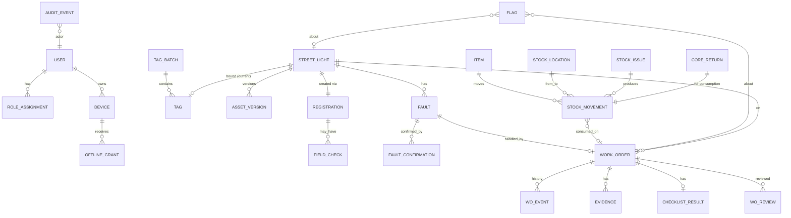

# 02 — Minimal Domain Model

Conventions for every table:
- `id uuid` (UUIDv7, may be generated on the device).
- `version int` for optimistic concurrency on mutable rows.
- `created_at timestamptz` in UTC. Display uses `Asia/Damascus` (configurable).
- Rows marked **append-only** get no UPDATE and no DELETE (enforced by DB grants and a trigger).
- No operational row is ever deleted.

## 2.1 Value objects

| Value object | Shape | Notes |
|---|---|---|
| `Money` | `amount numeric(19,4)`, `currency char(3)` (ISO 4217), `as_of date` | Default currency from config (`SYP`). No implicit conversion anywhere. Reference currency is optional config and **unset** in the pilot |
| `GeoPoint` | `geometry(Point, 4326)` + `accuracy_m real` | |
| `CaptureTime` | `device_time`, `elapsed_ms`, `boot_id`, `server_received_at`, `estimated_time`, `time_confidence (HIGH/LOW)` | see 05 |
| `ResponsibleParty` | `party (MUNICIPALITY/ELECTRICITY_AUTHORITY/OTHER_PUBLIC_ENTITY/SHARED)`, `entity_name text null` | on assets and faults |
| `PowerObservation` | `power_at_inspection (CONFIRMED_AVAILABLE/CONFIRMED_UNAVAILABLE/UNKNOWN)`, `power_info_source (OBSERVED_ON_SITE/ELECTRICITY_AUTHORITY/SCHEDULE/RESIDENT/OTHER) null`, `power_note text null` | no schedule is hard-coded |

## 2.2 Entities



### Access

```
organization          (single row) id, name_ar, name_en, time_zone, default_currency, map_center, map_bounds, settings jsonb
department            id, name_ar, name_en                                   -- one row in the pilot, table kept for growth
users                 id, idp_subject UNIQUE, display_name, employee_no, department_id, status[ACTIVE|DISABLED],
                      disabled_at, disabled_by, disable_reason, version
role_assignments      id, user_id, role, granted_by, granted_at, revoked_at, revoked_by, revoke_reason
                      -- scope is the single department in the pilot; column scope_ref kept nullable for growth
devices               id, user_id, platform, model, os_version, app_version, public_key (SPKI, from M6),
                      status[PENDING_APPROVAL|ACTIVE|REVOKED|REJECTED], requested_at, approved_by, approved_at,
                      revoked_by, revoked_at, revoke_reason, last_sync_at, last_reported_pending_commands, version
offline_grants        id, device_id, user_id, issued_at, expires_at, policy_hours, revoked_at      -- append + revoke only
policy_settings       key, value jsonb, changed_by, changed_at                 -- every change is audited
```

### Assets

```
tag_batches           id, prefix, quantity, created_by, created_at, printed_at
tags                  id, batch_id, code UNIQUE (e.g. T7K3M92QX), check_code, status[UNBOUND|BOUND|VOID],
                      issued_to_user_id null, bound_asset_id null, bound_at, voided_at, void_reason, version
street_lights         id, asset_code UNIQUE null (issued on approval, e.g. SL-000123),
                      lifecycle_state, operational_status,
                      location geometry(Point,4326), location_accuracy_m,
                      address_text, circuit_ref null,
                      power_source[GRID|SOLAR|HYBRID],
                      pole: {material, height_m} , luminaire: {make, model, wattage_w, serial},
                      solar: {panel_w, panel_serial, battery_type, battery_ah, battery_serial, controller_model} null,
                      installed_on date null, installed_on_precision[EXACT|YEAR|UNKNOWN],
                      warranty_until date null, supplier null,
                      responsible_party, responsible_entity_name,
                      source[FIELD_SURVEY|NEW_INSTALLATION|IMPORT], external_ref null,
                      current_tag_id, current_version_no, version
                      -- attributes stored as typed columns + jsonb for the nested groups, validated by JSON Schema
asset_versions        id, asset_id, version_no, snapshot jsonb, snapshot_hash, approved_by, approved_at, reason   -- append-only
registrations         id, asset_id, registrar_id, reason[BASELINE_SURVEY|NEW_INSTALLATION|MISSED_IN_SURVEY],
                      project_ref null, state, submitted_at, decided_by, decided_at, decision_note, version
field_checks          id, registration_id, requested_by, inspector_id, outcome[CONFIRMED|MISMATCH|NOT_FOUND] null,
                      evidence_id null, completed_at
asset_status_events   id, asset_id, from_status, to_status, cause_type[WORK_ORDER|FAULT|REGISTRATION], cause_id, at  -- append-only
```

### Faults

```
faults                id, asset_id, category[LIGHT_OFF|FLICKERING|DAY_BURNING|DAMAGED_POLE|EXPOSED_WIRES|MISSING_PARTS|OTHER],
                      source[INSPECTION|FIELD_STAFF|SUPERVISOR|PHONE_CALL],
                      reported_by, reported_at (estimated), power observation (see value object),
                      responsible_party (initially asset's; may change after diagnosis), description,
                      priority_suggestion[P1..P4], state, work_order_id null, version
fault_confirmations   id, fault_id, confirmed_by, at, evidence_id null, power observation            -- append-only
```

### Work orders

```
work_orders           id, code UNIQUE (WO-2026-000123), fault_id, asset_id, priority[P1..P4], state,
                      assignee_id null, sla_due_at, checklist_template_version_id,
                      diagnosis_code null, diagnosis_note null, root_cause_note null,
                      test_method null, risk_tier[STANDARD|HIGH] null,
                      rework_of_id null, closed_at null, seal_hash null, version
wo_events             id, work_order_id, seq, type, actor_id, device_id null, command_id null,
                      data jsonb, capture_time (see value object)                                         -- append-only
wo_arrivals           id, work_order_id, user_id, tag_scanned bool, manual_code_reason null,
                      location, accuracy_m, is_mock bool, presence_score int, presence_breakdown jsonb, estimated_time
checklist_templates   id, code (e.g. STREET_LIGHT_REPAIR), version, power_source_scope[ANY|SOLAR], items jsonb,
                      published_at, published_by                                                          -- immutable per version
checklist_results     id, work_order_id, template_id, answers jsonb, completed_at
wo_submissions        id, work_order_id, submission_no, submitted_by, report jsonb, payload_hash, submitted_at   -- append-only
wo_reviews            id, work_order_id, submission_id, reviewer_id, decision[APPROVE|RETURN], reasons jsonb,
                      opened_at, decided_at                                                              -- append-only
diagnosis_codes       code, name_ar, name_en, counts_as_failure bool, expected_items jsonb, requires_material bool
```

Pilot diagnosis codes (seeded, editable only through a migration or seed change, not a UI):

| Code | counts_as_failure | Notes |
|---|---|---|
| `LED_MODULE_FAIL` | yes | expects LED module |
| `DRIVER_FAIL` | yes | expects driver (core return) |
| `PHOTOCELL_FAIL` | yes | |
| `CABLE_FAULT` | yes | expects cable (m) |
| `FUSE` | yes | |
| `BATTERY_FAIL` | yes | solar: battery (core return) |
| `PANEL_DAMAGE` | yes | solar |
| `CONTROLLER_FAIL` | yes | solar |
| `GRID_SUPPLY_OFF` | **no** | no public-grid power; fault responsibility → `ELECTRICITY_AUTHORITY` (editable) |
| `THEFT` | **no** (counted separately) | police report ref optional |
| `VANDALISM` | **no** (counted separately) | |
| `NO_FAULT_FOUND` | no | |
| `ASSET_NOT_FOUND` | no | raises critical integrity flag |
| `ASSET_MISMATCH` | no | raises flag |

### Evidence

```
evidence              id, owner_type[WORK_ORDER|REGISTRATION|FIELD_CHECK|FAULT|CORE_RETURN|STOCK_ISSUE], owner_id,
                      kind[BEFORE|AFTER|TEST|TAG|ASSET_OVERVIEW|NAMEPLATE|CORE_PART|OTHER],
                      sha256_device, sha256_server null, size_bytes, mime,
                      captured_by, device_id, capture_time, location, accuracy_m, is_mock,
                      storage_key null, state[ANNOUNCED|UPLOADED|VERIFIED|HASH_MISMATCH|DUPLICATE],
                      superseded_by null, supersede_reason null
```

### Inventory

```
items                 id, sku UNIQUE, name_ar, name_en, unit[EA|M], serial_tracked bool, core_return_required bool
item_costs            id, item_id, money (amount, currency, as_of), set_by, set_at                         -- append-only
stock_locations       id, kind[WAREHOUSE|IN_TRANSIT|CUSTODY|CONSUMED|CORE_BIN|SUPPLIER], custodian_user_id null, name
stock_movements       id, type[RECEIPT|ISSUE|ACKNOWLEDGE|CONSUME|RETURN_DECLARE|RETURN_RECEIVE|CORE_RECEIVE|REVERSAL],
                      item_id, quantity numeric(12,3) > 0, from_location_id, to_location_id, serials text[],
                      stock_issue_id null, stock_return_id null, work_order_id null, asset_id null, reversal_of null,
                      actor_id, command_id null, occurred_at (estimated), recorded_at                      -- append-only
stock_balances        location_id, item_id, quantity                         -- updated in the same tx; nightly reconciliation
serial_units          serial, item_id, location_id, installed_asset_id null, status
stock_issues          id, requested_by (free reference to requester), issued_by, issued_to_user_id,
                      work_order_id null, lines jsonb, state, issued_at, acknowledged_at, version
stock_returns         id, declared_by, lines jsonb, state, declared_at, received_by, received_at, version
core_returns          id, consume_movement_id, user_id, item_id, serial null, declaration[WITH_PART|UNRECOVERABLE],
                      declaration_evidence_id, state, received_by, received_at, waived_by, waive_reason, due_at, version
```

### Audit, rules, sync

```
audit_events          seq bigint PK, event_id, occurred_at, actor_user_id, actor_roles text[], device_id,
                      action, entity_type, entity_id, entity_version, changes jsonb, reason,
                      command_id, correlation_id, payload_hash, prev_hash, hash                           -- append-only
audit_checkpoints     id, to_seq, last_hash, event_count, signature, created_at, anchor_key                -- append-only
rule_settings         rule_code, params jsonb, enabled, changed_by, changed_at
flags                 id, rule_code, severity[INFO|WARNING|CRITICAL], subject_type, subject_id,
                      explanation jsonb, state[OPEN|UNDER_REVIEW|CLOSED], outcome[CONFIRMED|NOT_CONFIRMED|EXPLAINED] null,
                      decided_by, decision_note, created_at
recommendations       id, asset_id, code[FULL_INSPECTION], explanation jsonb, state[OPEN|ACCEPTED|DISMISSED], decided_by
sync_commands         command_id PK, device_id, user_id, type, payload jsonb, payload_hash, grant_id,
                      capture_time, received_at, result, result_code, result_detail jsonb
sync_quarantine       id, command_id, reason_code, state[OPEN|RESOLVED], resolution[APPLY|DISCARD_WITH_RECORD], resolved_by, resolved_at, note
device_clock_samples  device_id, boot_id, server_time, elapsed_ms, device_time, at
```

**Asset history is a view, not a table.** `GET /assets/{id}/history` is composed from `asset_versions`, `asset_status_events`, `faults`, `work_orders` (+ events, reviews), `stock_movements` (asset_id) and `audit_events`. Keeping a separately maintained history table would create a second source of truth that drifts.

## 2.3 Synthetic demo data (no real municipality hard-coded)

`tools/seed` generates data **through the public API, logged in as seeded users**, so every seeded record has a real audit trail. Registrations go through `/sync/v1/push` from a dev-only, pre-approved **seed device**, with synthetic JPEG evidence, exactly like the phone would. Approvals go through the web API as a different user. The seed device exists only in the `dev` profile, and pilot configuration refuses to start if it is present.

- Organization "بلدية تجريبية / Demo Municipality" with the center taken from config (default: a neutral configurable coordinate).
- `N` street lights (default 300) on a generated street grid, with a configurable `solar_ratio` (default 0.3).
- Seeded users for every role (password from `.env`, dev only).
- Items and opening stock in one warehouse, with costs in `SYP`.
- History that makes the demo meaningful. For example, one light has **2 prior closed failures within 180 days**, so the demo repair triggers the repeated-failure flag. Another light is in `GRID_SUPPLY_OFF` context.

Seeding is deterministic from a seed value (`SEED=42`), so demos and tests are reproducible.
