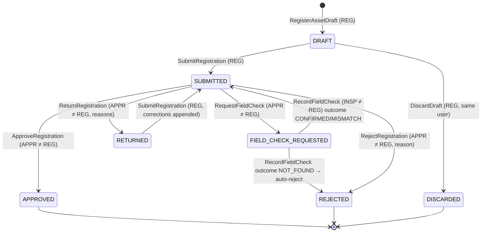
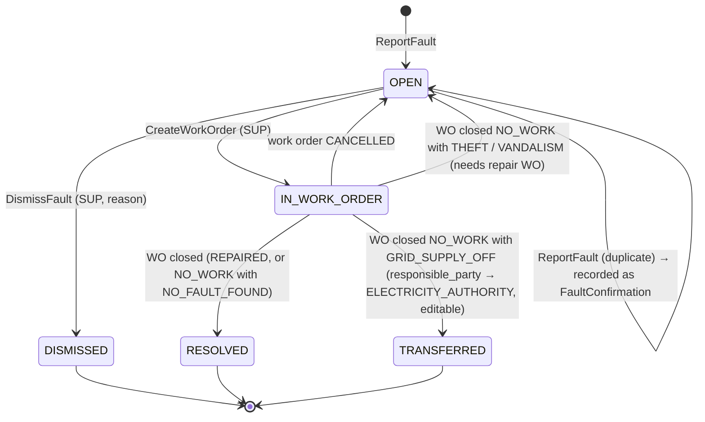
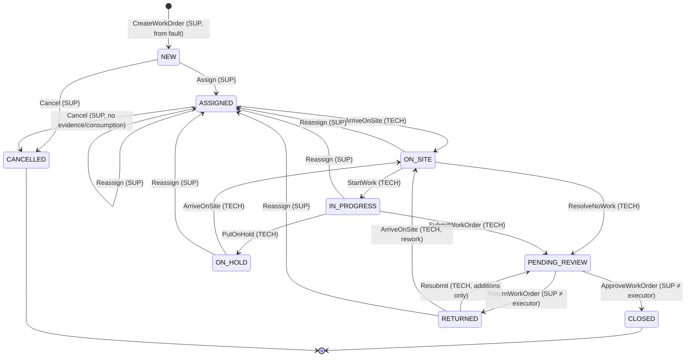
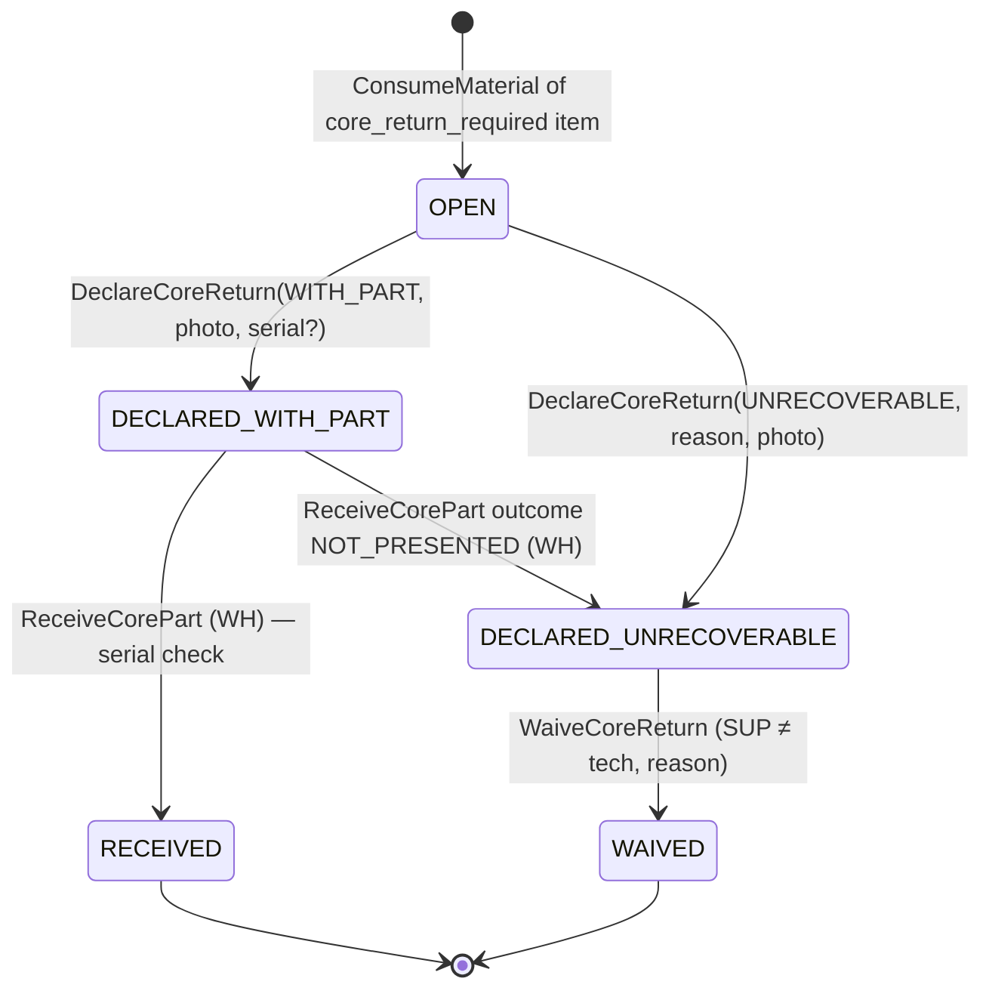

# 04 — Exact State Machines

**Rules for every machine:**
- A transition happens **only** through the named command. Any other (state, command) pair is rejected with `INVALID_TRANSITION` and nothing changes. The rejection itself is recorded in `sync_commands` or the request log, but is **not** an audit event because nothing changed.
- Every applied transition writes: the entity change, a domain event, and an `AuditEvent`, all in **one transaction**.
- Terminal states are marked ■. Nothing leaves a terminal state.
- M0 turns these tables into `docs/state-machines/<machine>.yaml`, and domain tests assert that the code matches them exactly (see 10).

---

## 4.1 Device

| From | Command | Actor | To | Guards / effects |
|---|---|---|---|---|
| — | `RegisterDevice` | user (authenticated on the phone) | `PENDING_APPROVAL` | Stores model, OS, app version and (from M6) public key. Any previous `PENDING_APPROVAL` device of the same user becomes `REJECTED` |
| `PENDING_APPROVAL` | `ApproveDevice` | SUPERVISOR / ADMIN | `ACTIVE` | The user's other `ACTIVE` device (if any) becomes `REVOKED` with reason `REPLACED`: **one active device per user** |
| `PENDING_APPROVAL` | `RejectDevice` | SUPERVISOR / ADMIN | `REJECTED` ■ | reason required |
| `ACTIVE` | `RevokeDevice` | SUPERVISOR / ADMIN | `REVOKED` ■ | reason required. Effects: all offline grants revoked, Keycloak sessions of the user on that client logged out, auth cache invalidated |
| `ACTIVE` | (automatic) `DisableUser` | ADMIN | `REVOKED` ■ | cascades from user disable |

## 4.2 User

| From | Command | Actor | To | Effects |
|---|---|---|---|---|
| `ACTIVE` | `DisableUser` | ADMIN | `DISABLED` | reason required. Keycloak user disabled + sessions revoked; all devices → `REVOKED`; grants revoked; open work orders flagged "needs reassignment"; custody balance ≠ 0 → `INFO` flag "custody to reconcile" |
| `DISABLED` | `EnableUser` | ADMIN | `ACTIVE` | reason required. **Devices stay revoked**, so a new device registration and approval is needed |

## 4.3 Tag

| From | Command | Actor | To | Guards / effects |
|---|---|---|---|---|
| — | `CreateTagBatch` | ADMIN | `UNBOUND` (×N) | generates codes + check codes |
| `UNBOUND` | `RegisterAssetDraft` (with tag) | REGISTRAR | `RESERVED` | tag must be `UNBOUND` and (if `issued_to` is set) issued to this registrar |
| `RESERVED` | registration `Approve` | APPROVER | `BOUND` | `bound_asset_id` set |
| `RESERVED` | registration `Reject` / `Discard` | APPROVER / REGISTRAR | `UNBOUND` | |
| `UNBOUND` / `BOUND` | `VoidTag` | ADMIN | `VOID` ■ | reason + optional photo. A `BOUND` void leaves the asset **without a tag** (re-tagging workflow deferred; the asset remains resolvable by `asset_code`) |

## 4.4 Registration (maker/checker)



| Command | Guards | Effects |
|---|---|---|
| `SubmitRegistration` | ≥ 1 `ASSET_OVERVIEW` photo and ≥ 1 `TAG` photo, location captured (accuracy recorded), required attributes valid against JSON Schema, `reason` set (`NEW_INSTALLATION` requires `project_ref`) | Proximity check: another active/pending street light within 5 m (configurable) → `WARNING` flag, visible to the approver, with the registrar's mandatory justification |
| `ApproveRegistration` | state `SUBMITTED`; all evidence `VERIFIED`; no open `CRITICAL` flag on the registration | Asset `lifecycle_state` → `ACTIVE`; `asset_code` issued (sequence `SL-000001`); `asset_versions` v1 with `snapshot_hash`; tag → `BOUND`; operational status set from the observation at capture |
| `RejectRegistration` | reason | Asset `lifecycle_state` → `REJECTED`; tag → `UNBOUND` |

## 4.5 Asset lifecycle

| From | Trigger | To |
|---|---|---|
| — | `RegisterAssetDraft` | `PENDING` |
| `PENDING` | registration approved | `ACTIVE` |
| `PENDING` | registration rejected / discarded | `REJECTED` ■ |
| `ACTIVE` | work order resolved with `ASSET_NOT_FOUND` | `UNDER_INVESTIGATION` |
| `UNDER_INVESTIGATION` | `ConfirmAssetExists` (APPROVER, with field-check evidence) | `ACTIVE` |

Deferred: decommissioning and retroactive rejection. In the pilot an investigated asset stays `UNDER_INVESTIGATION` until confirmed. **No new work order can be created for an asset that is not `ACTIVE`.**

## 4.6 Asset operational status (derived from events only; no manual edit)

| Event | From | To |
|---|---|---|
| Registration approved | — | observation at capture: `OPERATIONAL` / `FAULTY` / `UNKNOWN` |
| Fault reported (category ≠ `OTHER`) **and** power ≠ `CONFIRMED_UNAVAILABLE` | `OPERATIONAL`, `UNKNOWN` | `FAULTY` |
| Fault reported with power `CONFIRMED_UNAVAILABLE` | any | *(unchanged)* |
| `StartWork` | any | `UNDER_MAINTENANCE` |
| WO closed, outcome `REPAIRED`, test result `PASS` | `UNDER_MAINTENANCE` | `OPERATIONAL` |
| WO closed, outcome `REPAIRED`, test method `NOT_TESTED` | `UNDER_MAINTENANCE` | `UNKNOWN` (+ re-check recommendation) |
| WO closed, outcome `NO_WORK`, diagnosis `NO_FAULT_FOUND` | any | `OPERATIONAL` |
| WO closed, outcome `NO_WORK`, diagnosis `GRID_SUPPLY_OFF` | any | `OUT_OF_SERVICE_EXTERNAL` |
| WO closed, outcome `NO_WORK`, diagnosis `THEFT` / `VANDALISM` | any | `FAULTY` (a new work order is needed for the repair) |
| New fault reported with power `CONFIRMED_AVAILABLE` on a light that is `OUT_OF_SERVICE_EXTERNAL` | `OUT_OF_SERVICE_EXTERNAL` | `FAULTY` |

Each change writes `asset_status_events` with `cause_type` and `cause_id`.

## 4.7 Fault



- **Deduplication:** `ReportFault` on an asset that already has a fault in `OPEN` or `IN_WORK_ORDER` with the same category does not create a new fault. It adds a `FaultConfirmation` and returns result code `CONFIRMED_EXISTING`.
- Dismiss reasons (closed list): `DUPLICATE`, `NOT_A_FAULT`, `POWER_UNAVAILABLE_AT_REPORT`, `OUT_OF_MUNICIPAL_RESPONSIBILITY`, `OTHER` (+ note).
- A fault reported with power `CONFIRMED_UNAVAILABLE` is created and shown with a warning badge "power was unavailable at report time". **The supervisor decides.** Nothing is auto-dismissed.

## 4.8 Work order



### Transition table

| # | From | Command | Actor | Guards | Required evidence / data | Effects |
|---|---|---|---|---|---|---|
| W1 | — | `CreateWorkOrder` | SUP | fault `OPEN`; asset `ACTIVE`; no other non-terminal WO for this fault | priority | fault → `IN_WORK_ORDER`; `sla_due_at` from priority policy; checklist template version pinned (by `power_source`); `rework_of_id` set if the asset had a WO closed as `REPAIRED` ≤ 30 days ago (configurable) |
| W2 | `NEW` | `Assign` | SUP | assignee has `TECHNICIAN`, status `ACTIVE`, **has an `ACTIVE` device** | — | |
| W3 | `ASSIGNED`,`ON_SITE`,`IN_PROGRESS`,`ON_HOLD`,`RETURNED` | `Reassign` | SUP | same as W2; new assignee ≠ current | reason | → `ASSIGNED`; existing evidence and consumption stay attached; the old assignee loses write access |
| W4 | `NEW`,`ASSIGNED` | `Cancel` | SUP | **no evidence and no consumption exist** | reason | fault → `OPEN` |
| W5 | `ASSIGNED`,`ON_HOLD`,`RETURNED` | `ArriveOnSite` | assignee | device `ACTIVE`, grant valid (05) | tag scan **or** manual code + reason; location; **2 × `BEFORE` photos, ≥ 1 with the tag visible** (on first arrival; later arrivals: 1 photo) | `wo_arrivals` row with presence score (06) |
| W6 | `ON_SITE` | `StartWork` | assignee | diagnosis recorded (`RecordDiagnosis` is a non-transition command allowed in `ON_SITE`/`IN_PROGRESS`) | — | asset → `UNDER_MAINTENANCE`; work timer starts at the estimated time of this command |
| W7 | `ON_SITE` | `ResolveNoWork` | assignee | diagnosis ∈ {`NO_FAULT_FOUND`,`GRID_SUPPLY_OFF`,`THEFT`,`VANDALISM`,`ASSET_NOT_FOUND`,`ASSET_MISMATCH`} | 1 photo proving the reason (e.g. light on / empty spot / cut cable); power observation for `GRID_SUPPLY_OFF` | outcome = `NO_WORK`; `ASSET_NOT_FOUND` → `CRITICAL` flag + asset → `UNDER_INVESTIGATION` at close |
| W8 | `IN_PROGRESS` | `PutOnHold` | assignee | — | reason ∈ {`WAITING_PARTS`,`NO_ACCESS`,`SAFETY`,`EQUIPMENT`,`OTHER`} + note | timer paused |
| W9 | `IN_PROGRESS` | `SubmitWorkOrder` | assignee | checklist complete for the pinned template; materials recorded **or** explicit "no materials" (if diagnosis `requires_material` → justification text mandatory and risk `HIGH`); every consumed `core_return_required` item has a core-return **declaration**; root-cause note | **≥ 2 `AFTER` photos**; **1 `TEST` photo** unless test method = `NOT_TESTED` (reason mandatory) | outcome = `REPAIRED`; submission row with `payload_hash`; risk tier computed |
| W10 | `PENDING_REVIEW` | `ApproveWorkOrder` | SUP ≠ executor | **all evidence of the WO in state `VERIFIED`** (none `ANNOUNCED`/`UPLOADED`/`HASH_MISMATCH`); no open `CRITICAL` flag on the WO unless the reviewer records an explicit acknowledgment note | — | → `CLOSED`; `seal_hash` computed and audited (06); asset status per 4.6; fault per 4.7; **repeated-failure rule evaluated** |
| W11 | `PENDING_REVIEW` | `ReturnWorkOrder` | SUP ≠ executor | — | reasons (checklist of what is missing + note) | |
| W12 | `RETURNED` | `Resubmit` | assignee | only **additions**: new evidence, extra notes, extra consumption/corrections as new records | same requirements as W9 or W7 re-evaluated | new submission row; the reviewer sees the diff between submissions |

**Non-transition commands** (allowed only in the listed states, by the assignee): `AddEvidence` (`ON_SITE`,`IN_PROGRESS`,`ON_HOLD`,`RETURNED`), `RecordDiagnosis` (`ON_SITE`,`IN_PROGRESS`), `ConsumeMaterial` (`IN_PROGRESS`,`RETURNED`), `DeclareCoreReturn` (`IN_PROGRESS`,`RETURNED`, and after close until received), `RecordChecklist` (`IN_PROGRESS`,`RETURNED`).

**Risk tier (pilot).** `HIGH` if any of these holds: presence score < 40 on any arrival; `is_mock` on any evidence; consumption exceeds known custody; an expected material is missing; test `NOT_TESTED`; a core return declared `UNRECOVERABLE`; an open `WARNING`/`CRITICAL` flag on the WO. In the pilot, `HIGH` highlights the WO in the review queue and raises an `INFO` flag to the auditor. **A second approver is deferred.**

**Closed means closed.** No command changes a `CLOSED` WO. Post-closure amendment is deferred. Until then, corrections go through a note on a flag decided by the auditor, and the original stays as it is.

## 4.9 Stock issue

| From | Command | Actor | To | Effects (movements) |
|---|---|---|---|---|
| — | `IssueStock` | WAREHOUSE | `ISSUED` | `ISSUE`: WAREHOUSE → IN_TRANSIT (per line, serials for serial-tracked items). Stock cannot go negative in WAREHOUSE (rejected) |
| `ISSUED` | `AcknowledgeStockIssue` | receiving TECH | `ACKNOWLEDGED` ■ | `ACKNOWLEDGE`: IN_TRANSIT → CUSTODY(tech); serials confirmed by scan or tick |
| `ISSUED` | `DisputeStockIssue` | receiving TECH | `DISPUTED` | reason + optional photo; `WARNING` flag |
| `ISSUED`,`DISPUTED` | `CancelStockIssue` | WAREHOUSE | `CANCELLED` ■ | `REVERSAL`: IN_TRANSIT → WAREHOUSE; reason |
| `ISSUED` | (timer) not acknowledged after 24 h (policy) | system | *(unchanged)* | `WARNING` flag `ISSUE_UNACKNOWLEDGED` |

## 4.10 Stock return (unused material)

| From | Command | Actor | To | Effects |
|---|---|---|---|---|
| — | `DeclareStockReturn` | TECH | `DECLARED` | `RETURN_DECLARE`: CUSTODY → IN_TRANSIT |
| `DECLARED` | `ReceiveStockReturn` | WAREHOUSE | `RECEIVED` ■ | `RETURN_RECEIVE`: IN_TRANSIT → WAREHOUSE; serials matched |
| `DECLARED` | `RejectStockReturn` | WAREHOUSE | `REJECTED` ■ | `REVERSAL`: IN_TRANSIT → CUSTODY(tech); reason; `WARNING` flag |

## 4.11 Core return (failed part)



- **Serial check at receipt:** if the item is serial-tracked and the asset has a known installed serial for that item, the presented serial must match it. A mismatch still records the receipt but raises a `CRITICAL` flag `CORE_SERIAL_MISMATCH`.
- `DECLARED_WITH_PART` not received within 7 days (policy) → `WARNING` flag `CORE_RETURN_OVERDUE`.
- `WaiveCoreReturn` always raises an `INFO` flag to the auditor.

## 4.12 Flag

| From | Command | Actor | To |
|---|---|---|---|
| — | rule fires | system | `OPEN` |
| `OPEN` | `StartFlagReview` | AUDITOR | `UNDER_REVIEW` |
| `OPEN`,`UNDER_REVIEW` | `DecideFlag(outcome, note)` | AUDITOR | `CLOSED` ■ (outcome `CONFIRMED` / `NOT_CONFIRMED` / `EXPLAINED`) |

## 4.13 Offline grant

| From | Trigger | To |
|---|---|---|
| — | `POST /sync/v1/grant` (online, user and device `ACTIVE`) | `VALID` (`expires_at = issued_at + policy.offline_grace_hours`) |
| `VALID` | time passes `expires_at` | `EXPIRED` ■ |
| `VALID` | device revoked / user disabled / new grant issued | `REVOKED` ■ |

## 4.14 Machine-readable format (created in M0)

```yaml
# docs/state-machines/work-order.yaml  (excerpt)
machine: WorkOrder
states: [NEW, ASSIGNED, ON_SITE, IN_PROGRESS, ON_HOLD, PENDING_REVIEW, RETURNED, CLOSED, CANCELLED]
terminal: [CLOSED, CANCELLED]
transitions:
  - {id: W5, from: [ASSIGNED, ON_HOLD, RETURNED], command: ArriveOnSite, to: ON_SITE, actor: assignee,
     requires: [tag_scan_or_manual_reason, location, before_photos]}
  - {id: W10, from: [PENDING_REVIEW], command: ApproveWorkOrder, to: CLOSED, actor: SUPERVISOR,
     policy: [reviewer_not_executor], requires: [all_evidence_verified]}
```
