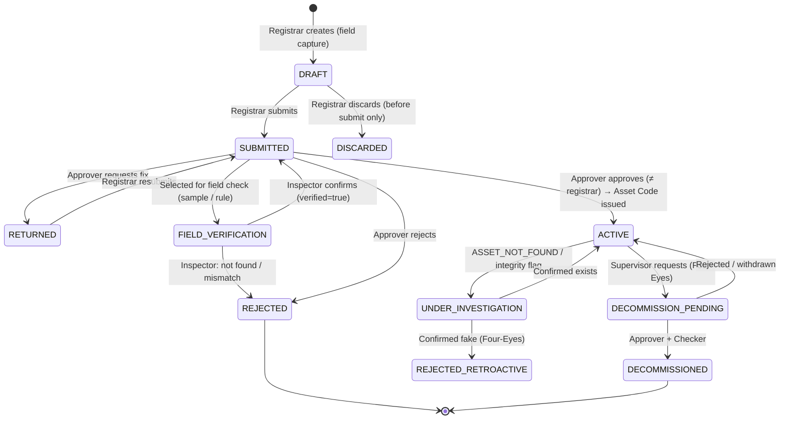

# 04 — دورة حياة الأصل والتحقق منه

## 4.1 تصنيف الكيانات

| الفئة | أمثلة | التمثيل | المرحلة |
|---|---|---|---|
| **Point Asset** أصل نقطي | نقطة إنارة، لوحة تغذية، مضخة، إشارة | `geometry: Point` | Phase 1 (الإنارة + اللوحة) |
| **Linear Asset** أصل خطي | طريق، خط مياه، قناة | `geometry: LineString` + Segments بـ Linear Referencing (من م — إلى م) | Phase 3 |
| **Mobile Asset** أصل متنقل | مركبة، مولد متنقل، معدة | بدون موقع ثابت؛ عدّاد (كم/ساعات تشغيل) | Phase 3 |
| **Facility** منشأة | مبنى، حديقة | `Polygon` + أصول فرعية | Phase 3 |
| **Issue** مشكلة | حفرة، تسرب، تراكم نفايات، عمود مطفأ | حدث مرتبط بموقع و/أو أصل — **ليس أصلًا** | Phase 1 |

**ملاحظة على الأصول المتنقلة:** الفكرة الأصلية أدرجت المركبات ضمن "Individual Assets". المركبات مختلفة جوهريًا: الصيانة تُقاد بالعدّاد لا بالعطل، والموقع متغير، و"الحضور" يكون في الورشة. نصممها كفئة مستقلة في Phase 3 بدل إجبارها على نموذج الأصل النقطي.

## 4.2 نموذج الإنارة في MVP

```
Feeder Pillar / Lighting Cabinet (FP-000123)     ← أصل نقطي من نوع "لوحة تغذية"
 └── Circuit C1, C2, C3 ...                       ← حقل مرجعي بسيط (ليس أصلًا في MVP)
      └── Light Point (SL-003821)                 ← الأصل الرئيسي = "نقطة إنارة"
           ├── pole: {material, height_m, condition}
           ├── luminaire: {make, model, wattage, serial?, installed_on, warranty_until}
           ├── driver: {make, model, serial?}     ← اختياري
           └── photocell / control: {type}
```

**قرار: الأصل هو "نقطة الإنارة" لا "العمود" ولا "الكشاف".**
- العمود نادرًا ما يُستبدل؛ الكشاف يُستبدل كثيرًا.
- استبدال الكشاف **لا يغير هوية الأصل** — يُسجل كـ "Component Replacement" في تاريخه، مع الرقم التسلسلي القديم والجديد.
- تتبع المكونات كأصول مستقلة (Component-level asset tracking) مؤجل؛ المكونات هنا **سمات مُصدَّرة (Versioned attributes)** على الأصل.

## 4.3 حالات الأصل (بُعدان مستقلان)

### Lifecycle State — رسمية السجل



- `DISCARDED` مسموح فقط للمسودة غير المقدمة، ويُحفظ أثرها في التدقيق (لا حذف فعلي).
- `REJECTED_RETROACTIVE`: أصل وهمي اكتُشف بعد اعتماده. **لا يُحذف**؛ كل أوامر العمل والمواد المرتبطة به تُدرج تلقائيًا في طابور تدقيق.
- `UNDER_INVESTIGATION` يمنع إنشاء أوامر عمل جديدة للأصل (إلا بـ Break Glass للطوارئ).

### Operational Status — هل يعمل الآن

`OPERATIONAL · DEGRADED · FAULTY · UNDER_MAINTENANCE · OUT_OF_SERVICE · UNKNOWN`

- تتغير **فقط** عبر أحداث: بلاغ مؤكد → `FAULTY`؛ بدء عمل → `UNDER_MAINTENANCE`؛ إغلاق باختبار ناجح → `OPERATIONAL`؛ عطل خارجي (اللوحة) → `OUT_OF_SERVICE` للأعمدة المتأثرة مع `cause_ref`.
- لا يوجد "تغيير الحالة يدويًا" من واجهة الإدارة. (يمنع "تجميل" لوحة المؤشرات.)
- `UNKNOWN`: الحالة الافتراضية بعد الجرد إذا لم يُفحص الأصل ليلًا.

## 4.4 إدارة الملصقات (Tags)

**الملصق كيان مستقل خاضع للرقابة:**

```
Tag: { tag_id, batch_id, qr_payload, status, custodian, bound_asset_id?, history[] }
Status: PRINTED → IN_STOCK → ISSUED_TO(custodian) → BOUND(asset) → [DAMAGED | VOID]
```

**محتوى QR:** رابط قصير + Tag ID + رمز تحقق قصير:
`https://<domain>/t/T7K3M92QX.4F`
- الرابط يسمح لاحقًا (Phase 4) لأي مواطن بمسحه للإبلاغ.
- رمز التحقق (Checksum/HMAC مختصر) يرفض الملصقات المطبوعة خارج النظام **(لا يمنع النسخ — النسخ ممكن دائمًا؛ يمنع اختلاق أرقام جديدة)**.
- لا يحمل QR أي بيانات عن الأصل. البيانات في الخادم.
- **رقم مقروء بشريًا مطبوع بجانب QR** (للإدخال اليدوي عند تلف الـ QR أو ضعف الكاميرا).

**مواصفات مادية (توصية تشغيلية):** ألومنيوم مطبوع أو ملصق UV-resistant بمادة لاصقة صناعية؛ الارتفاع 1.5–2م على العمود؛ الاتجاه نحو الرصيف. هذه تفاصيل تؤثر على نجاح المشروع أكثر مما تبدو.

**رقابة العهدة:** كل مسجّل يستلم دفعة (مثلًا 200 ملصق من `T..001` إلى `T..200`) بتأكيد استلام في تطبيقه. نهاية كل يوم/أسبوع: `مستخدم + متبقٍ + تالف (بصورة)` = المستلم. العجز ← Flag.

**إعادة الترقيم (Re-tagging):** الملصق القديم يُعلَّم `VOID` مع سبب وصورة، والجديد يُربط. تاريخ الملصقات محفوظ. أصل تغير ملصقه > مرتين في سنة ← Flag.

## 4.5 Workflow: تسجيل أصل (ميداني)

```
[Registrar — Mobile, يعمل دون اتصال]
 1. "أصل جديد" → اختيار النوع (Light Point / Feeder Pillar)
 2. مسح ملصق من عهدته (يُرفض ملصق غير مسند إليه أو مربوط مسبقًا)
 3. التقاط الموقع (انتظار دقة ≤ 10م أو تجاوز مع سبب؛ تسجيل الدقة الفعلية)
 4. تنبيه القرب: "يوجد أصل من نفس النوع على بعد 3م — هل هو نفسه؟" → تبرير إلزامي إن استمر
 5. صور إلزامية (كاميرا التطبيق فقط):
      - صورة شاملة للأصل كاملًا
      - صورة قريبة للملصق بعد تثبيته
      - صورة لوحة البيانات / الكشاف (إن أمكن)
 6. السمات: المواصفات الأساسية (قائمة قصيرة مع قيم افتراضية ذكية من آخر أصل مسجل)
      + تاريخ التركيب: معروف / تقديري (سنة) / مجهول
      + مرجع الدائرة/اللوحة (اختياري في الجرد)
 7. الحالة الظاهرية عند المسح: يعمل / لا يعمل / غير معروف (نهارًا)
 8. سبب التسجيل: BASELINE_SURVEY (خلال الجرد) | NEW_INSTALLATION(project_ref) | REPLACEMENT(old_asset) | RELOCATION(old_asset) | MISSED_IN_SURVEY(justification)
 9. حفظ كمسودة → تقديم (فرديًا أو دفعة)
```

**هدف الأداء:** ≤ 60 ثانية للأصل في الجرد الأساسي. إذا تجاوزنا ذلك، الجرد سيكون مكلفًا وسيُختصر عمليًا.

**بعد انتهاء الجرد الأساسي للمنطقة** (المنطقة تُعلن "Baseline Closed" بقرار موثق):
- `BASELINE_SURVEY` لم يعد مسموحًا.
- `NEW_INSTALLATION` يتطلب مرجع مشروع موجود في النظام (Project/Contract reference — كيان بسيط في MVP: رقم + وصف + عدد الأصول المتوقع).
- **عدد الأصول المسجلة على مشروع لا يتجاوز العدد المتوقع** دون موافقة — ضابط بسيط وقوي.
- `MISSED_IN_SURVEY` يتطلب تحققًا ميدانيًا 100%.

## 4.6 Workflow: التحقق والاعتماد

```
[Approver — Web]
طابور "أصول بانتظار الاعتماد" مرتبة حسب المخاطرة
لكل أصل (شاشة واحدة مُحسَّنة للسرعة):
  - الصور (مكبرة)، الموقع على الخريطة مع دائرة الدقة، الأصول المجاورة
  - إشارات آلية: قرب مكاني، pHash مشابه، دقة GPS ضعيفة، Mock location،
    تسجيل سريع جدًا (أصلان في 20 ثانية بفارق 300م = مستحيل)، خارج حدود المنطقة
  - [اعتماد] [إرجاع للتصحيح] [طلب تحقق ميداني] [رفض]
  - اختصارات لوحة مفاتيح للاعتماد السريع
```

**اختيار العينة الميدانية (Risk-based sampling):**

| الحالة | نسبة التحقق الميداني |
|---|---|
| أساس الجرد | 5% عشوائية |
| مسجّل جديد (أول 100 أصل) | 15% |
| مسجّل لديه رفض سابق مؤكد | 25% لمدة 30 يومًا |
| أصل عليه إشارة آلية | 100% (أو قرار المعتمد بالتجاوز مع سبب) |
| `NEW_INSTALLATION`, `MISSED_IN_SURVEY` | 100% |

**الاختيار العشوائي يتم على الخادم** بمولد عشوائي آمن (CSPRNG) عند التقديم، ولا يعرفه المسجّل. المفتش المختار **ليس من فريق المسجّل**.

**التحقق الميداني:** المفتش يمسح الملصق، يلتقط صورة، ويؤكد (موجود ويطابق / موجود لا يطابق / غير موجود). لا يرى صور المسجّل **قبل** التقاط صورته (يمنع "التأكيد بالنظر").

**عند الاعتماد:**
- يُصدر Asset Code رسمي (تسلسل لكل نوع: `SL-`, `FP-`).
- السجل ينتقل لـ `ACTIVE`، والنسخة المعتمدة تُختم (Hash) في سجل التدقيق.

## 4.7 Workflow: تعديل أصل معتمد

أي تغيير في السمات **الجوهرية** بعد الاعتماد (الموقع > 15م، النوع، الطراز، تاريخ التركيب، الضمان) = `ApprovalRequest(ASSET_CHANGE)`.
السمات **غير الجوهرية** (ملاحظات، صورة مرجعية إضافية) تُعدَّل مباشرة مع حدث تدقيق.

قائمة "الجوهري" قابلة للتهيئة لكل نوع أصل.

**الأصل له إصدارات (Versioned):** `asset_versions` تحفظ كل نسخة معتمدة. عرض الأصل "كما كان في تاريخ X" ممكن دائمًا — ضروري للتدقيق (ما الطراز الذي كان مركبًا عندما صُرف هذا الـ Driver؟).

## 4.8 Workflow: الشطب (Decommission)

```
Supervisor: طلب شطب → السبب (تالف/حادث/استبدال/إزالة مشروع) + صور + تاريخ
          + الأصل البديل (إن وُجد) + المكونات المستردة (Salvage)
Approver: موافقة أولى  →  Department Manager: موافقة ثانية (Checker)
     → DECOMMISSIONED
     → المكونات المستردة تُنشئ حركة إرجاع للمخزن (مرتبطة) — يجب أن يستلمها أمين المخزن
     → الملصق يُعلم VOID
```

إذا كان الشطب بسبب حادث (سيارة صدمت العمود): حقل مرجع محضر الحادث/التأمين — **هذه تكلفة قابلة للاسترداد** وغالبًا تضيع.

## 4.9 Workflow: الجرد الأساسي (Baseline Inventory) لمنطقة

```
1. تعريف المنطقة (مضلع على الخريطة) + فريق المسح + دفعات الملصقات
2. (اختياري) استيراد بيانات موجودة (Excel/Shapefile/GIS) كـ "Candidate Points"
     → تظهر للمسجل كنقاط مقترحة على الخريطة؛ لا تصبح أصولًا دون مسح ميداني
3. المسح الميداني (نهارًا للبيانات + جولة ليلية لحالة التشغيل)
4. المراجعة والاعتماد والعينة الميدانية
5. تقرير التغطية: نقاط مقترحة لم تُمسح، مسوحات بلا مقابل في البيانات القديمة
6. قرار "إغلاق الجرد الأساسي للمنطقة" (مدير القسم، موثق)
```

**لماذا الاستيراد كنقاط مرشحة فقط؟** البيانات القديمة هي بالضبط ما لا نثق به. استيرادها كأصول معتمدة يلوث السجل من اليوم الأول. لكنها مفيدة كخريطة إرشادية وكمقياس لجودة البيانات القديمة (تقرير الفرق مفيد جدًا للإدارة).

## 4.10 سياسة عدم الحذف

| الكيان | يُحذف؟ | البديل |
|---|---|---|
| أصل | لا | DISCARDED (مسودة) / REJECTED / DECOMMISSIONED |
| أمر عمل | لا | CANCELLED (قبل أي أدلة) / CLOSED_NOT_DONE |
| دليل (صورة) | لا | `superseded_by` + سبب (مثلًا صورة خاطئة استُبدلت قبل التقديم — تبقى محفوظة ومرئية للمدقق) |
| حركة مخزون | لا | حركة عكسية (Reversal) مرتبطة |
| مستخدم | لا | DISABLED |
| حدث تدقيق | لا، أبدًا | — |

**استثناء وحيد:** بيانات شخصية تنتهي مدة الاحتفاظ بها وفق السياسة (مثلًا دقة GPS التفصيلية لحركة الفني بعد N سنوات) تُحذف أو تُعمى (Redaction) بعملية موثقة ومجدولة **تُسجل هي نفسها في سجل التدقيق** دون تعديل أحداث التدقيق (الأحداث تشير للبيانات ولا تحتويها — انظر [07](07-evidence-audit-integrity.md)).
