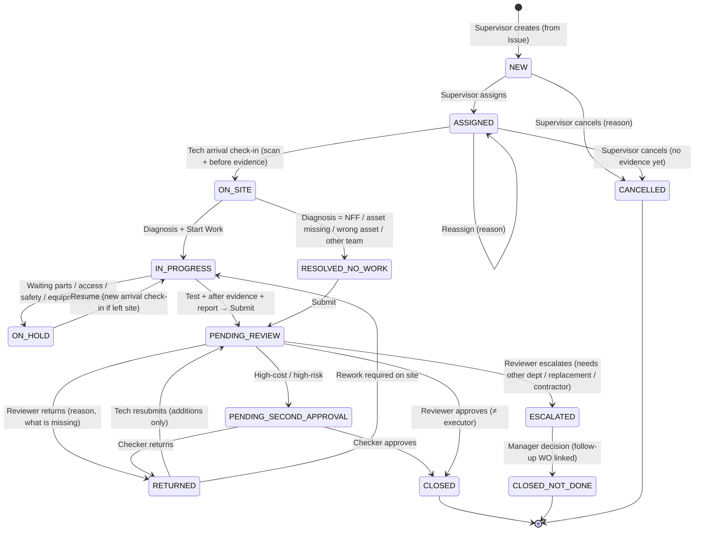

# 05 — البلاغات وأوامر العمل

## 5.1 البلاغ (Issue) ≠ أمر العمل (Work Order)

| | Issue | Work Order |
|---|---|---|
| ما هو | **ملاحظة** أن شيئًا ما خطأ | **قرار** بتخصيص موارد لإصلاحه |
| من ينشئه | أي مستخدم ميداني، (لاحقًا) مواطن، (لاحقًا) أنظمة | المشرف |
| العلاقة | Issue واحد → 0..N أوامر عمل | أمر عمل واحد ← 1..N Issues (دمج) |
| مثال | "العمود SL-3821 مطفأ" ×12 بلاغًا من جولة | "إصلاح لوحة FP-123 — الدائرة C2" يغطي 12 عمودًا |

**مصادر البلاغ في MVP:** `INSPECTION_ROUND` (جولة تفقد) · `FIELD_STAFF` (اكتشاف أثناء مهمة) · `SUPERVISOR` · `PHONE_CALL` (مكالمة مواطن يسجلها موظف — مصدر حقيقي اليوم يجب ألا نهمله).

### إزالة التكرار الداخلي (Internal Dedup) — MVP

عند إنشاء بلاغ على أصل له بلاغ مفتوح من نفس الفئة:
- لا يُنشأ بلاغ جديد. يُضاف **تأكيد (Confirmation)** للبلاغ الموجود (من، متى، صورة).
- البلاغ بلا أصل (موقع فقط): مطابقة مكانية (≤ 25م، نفس الفئة، آخر 14 يومًا) → اقتراح الدمج، والمستخدم يقرر.

نفس الآلية ستخدم بلاغات المواطنين في Phase 4 ("1 Issue, confirmed by 50 reports").

### حالات البلاغ

`OPEN → TRIAGED → (LINKED_TO_WO) → RESOLVED | REJECTED(not a fault / duplicate / out of scope)`
البلاغ يُحل تلقائيًا عند إغلاق كل أوامر العمل المرتبطة بنجاح.

## 5.2 أمر العمل — البنية

```
WorkOrder
  code                : WO-2026-008842
  type                : CORRECTIVE | INSPECTION_FOLLOWUP | (Phase 2: PREVENTIVE)
  priority            : P1 (خطر سلامة — كابل مكشوف) | P2 | P3 | P4
  primary_asset       : الأصل الذي يُتوقع أن يكون موضع العمل (قد يتغير بعد التشخيص — بحدث موثق)
  affected_assets[]   : الأصول المتأثرة (الأعمدة المطفأة بسبب اللوحة)
  issues[]            : البلاغات المرتبطة
  work_template       : نوع المهمة (يحدد: الأدلة المطلوبة، قائمة الفحص، مستوى المخاطرة)
  risk_tier           : LOW | STANDARD | HIGH  (محسوب — انظر 5.6)
  assignee            : فني رئيسي (+ مساعدون)
  sla_due_at          : حسب الأولوية
  state               : انظر آلة الحالات
  events[]            : سجل كامل (Append-only) لكل ما حدث
```

## 5.3 آلة حالات أمر العمل



### قواعد جوهرية

1. **CLOSED حالة نهائية.** لا "إعادة فتح". إذا تعطل الأصل مجددًا → أمر عمل جديد بعلاقة `rework_of` إذا كان خلال 30 يومًا (يُحسب كـ Rework ويؤثر على "نسبة الإصلاح من المرة الأولى").
2. **CANCELLED مسموح فقط قبل وجود أي دليل أو استهلاك.** بعدها الطريق الوحيد للخروج هو المراجعة.
3. **RETURNED → PENDING_REVIEW بالإضافة فقط.** الفني يضيف أدلة أو يصحح بحدث تصحيح؛ لا يحذف ما قدمه. المراجع يرى ما تغير بين التقديمين (Diff).
4. **ON_HOLD بسبب قطع** يولد تلقائيًا طلب مواد مرتبطًا (إن لم تكن في العهدة).
5. **الإسناد المزدوج:** الفني المساعد يستطيع إضافة أدلة، والرئيسي فقط يقدّم.
6. **كل انتقال = Command** يُتحقق منه على الخادم (الحالة الحالية + الصلاحية + الشروط + الأدلة المطلوبة)، ويُنتج `WorkOrderEvent` + `AuditEvent` في نفس المعاملة.

### جدول الانتقالات (مختصر)

| من → إلى | الفاعل | الشروط (Guards) | الأدلة المطلوبة |
|---|---|---|---|
| NEW → ASSIGNED | مشرف | الفني في النطاق، الأصل ACTIVE (أو UNDER_INVESTIGATION + Break Glass) | — |
| ASSIGNED → ON_SITE | الفني المسند | — | مسح Tag (أو إدخال يدوي + سبب) · موقع · صورتان Before (إحداهما فيها Tag) |
| ON_SITE → IN_PROGRESS | الفني | تشخيص أولي (نوع العطل من قائمة + نص) | — |
| ON_SITE → RESOLVED_NO_WORK | الفني | سبب من قائمة | صورة تثبت السبب (العمود مضيء / موقع فارغ) |
| IN_PROGRESS → PENDING_REVIEW | الفني | قائمة الفحص مكتملة · المواد مسجلة (أو "لا مواد") · سبب العطل الجذري · Core Return مُعلن للقطع المطلوبة | صور After (≥ 2) · صورة اختبار وظيفي حين ممكن |
| PENDING_REVIEW → CLOSED | مشرف ≠ المنفذ | كل الأدلة موجودة ومرفوعة فعلًا (ليس فقط بياناتها) · لا Flags حرجة مفتوحة | — |
| PENDING_REVIEW → PENDING_SECOND_APPROVAL | تلقائي | تكلفة > عتبة، أو HIGH risk | — |

**"مرفوعة فعلًا":** في وضع عدم الاتصال، الفني قد يقدّم وبياناته وصلت لكن الصور لم تُرفع بعد. المراجع **لا يستطيع الإغلاق** حتى يتحقق الخادم من وصول كل الملفات ومطابقة الـ Hash. الواجهة توضح "بانتظار رفع 3 صور".

## 5.4 التشخيص ونتائجه

قائمة تشخيص **مغلقة** لكل نوع أصل (تُهيأ)، مثلًا للإنارة:

| رمز | التشخيص | الأثر |
|---|---|---|
| `LAMP_FAIL` | فشل وحدة LED / المصباح | مواد متوقعة: LED Module |
| `DRIVER_FAIL` | فشل Driver | Driver + Core Return |
| `PHOTOCELL_FAIL` | فشل الخلية الضوئية | — |
| `CABLE_FAULT` | عطل كابل / توصيلة | كابل (كمية) |
| `FUSE` | فيوز | — |
| `SUPPLY_FAULT_UPSTREAM` | لا تغذية — السبب في اللوحة/الشبكة | **تحويل**: الأصل الرئيسي يصبح اللوحة، والأعمدة متأثرة |
| `VANDALISM` | تخريب | مرجع بلاغ أمني (اختياري) |
| `ACCIDENT` | حادث | مرجع محضر (قابل للاسترداد) |
| `NFF` | لا يوجد عطل | إعادة تحقق ليلي |
| `ASSET_NOT_FOUND` | الأصل غير موجود في موقعه | **يفتح تحقيق نزاهة على الأصل** |
| `ASSET_MISMATCH` | الأصل يختلف عن السجل | طلب تصحيح أصل |

**التشخيص يحدد "الاستهلاك المتوقع"** لكل نوع مهمة (مثلًا DRIVER_FAIL: Driver ×1، كابل 0–2م). الاستهلاك خارج النطاق المتوقع لا يُمنع — يتطلب **تبريرًا نصيًا** ويُعلّم للمراجع. هذا "Soft limit".

والعكس أيضًا: تشخيص يتوقع مادة إلزامية (مثل `DRIVER_FAIL`) مع تسجيل "لا مواد" يتطلب تبريرًا ويرفع مستوى المخاطرة إلى HIGH — هذا يكشف القطع المستخدمة دون تسجيل.

## 5.5 قائمة الفحص بعد الإصلاح (Checklists)

**Checklist Template** مُصدَّرة (Versioned) لكل نوع أصل × نوع مهمة. أمر العمل يربط **نسخة القالب** عند الإنشاء — تغيير القالب لاحقًا لا يغير ما طُلب من مهمة قديمة.

عنصر القالب: `{key, label_ar, label_en, type: bool|choice|number|photo|text, required, fail_values, requires_photo_if}`

**قالب نقطة إنارة — إصلاح تصحيحي (v1):**

| # | البند | النوع | ملاحظة |
|---|---|---|---|
| 1 | طريقة الاختبار | اختيار: ليلي مباشر / تغطية الخلية / تجاوز مؤقت / لم يُختبر | "لم يُختبر" → سبب + يُجدول تحقق ليلي |
| 2 | هل الضوء يعمل؟ | نعم/لا | إلزامي إلا إذا "لم يُختبر" · صورة إذا نعم (مستحسنة جدًا) |
| 3 | هل الإضاءة مستقرة (بلا وميض)؟ | نعم/لا | |
| 4 | الغطاء/باب العمود مثبت ومغلق | نعم/لا | صورة إلزامية لباب العمود |
| 5 | لا توجد أسلاك مكشوفة | نعم/لا | "لا" = لا يمكن التقديم كـ "تم"؛ تحويل لـ P1 |
| 6 | ضرر ظاهر في العمود | لا / طفيف / جسيم | جسيم → اقتراح بلاغ جديد |
| 7 | يحتاج فحصًا كهربائيًا إضافيًا | نعم/لا | نعم → بلاغ متابعة |

**مبدأ:** قائمة قصيرة (≤ 8 بنود). كل بند إضافي يقلل جودة الإجابة على كل البنود.

## 5.6 مستوى المخاطرة (Risk Tier)

يُحسب عند التقديم (ليس عند الإنشاء — لأنه يعتمد على ما حدث):

| المستوى | الشروط (أي منها) | المراجعة |
|---|---|---|
| **HIGH** | قيمة المواد > عتبة · قطع عالية القيمة بلا Core Return · إشارة نزاهة (pHash، GPS، ساعة) · ASSET_NOT_FOUND · أصل تحت التحقيق · Break Glass | مشرف + Checker |
| **STANDARD** | الافتراضي | مشرف (مراجعة كاملة) |
| **LOW** | مهمة بلا مواد أو مواد منخفضة القيمة ضمن المتوقع · كل الأدلة كاملة · لا إشارات · اختبار ليلي مباشر ناجح | مشرف (Phase 1) → مراجعة مختصرة (Phase 2) |

وكل المستويات تخضع لـ **Random Audit** مستقل (انظر [07](07-evidence-audit-integrity.md)).

## 5.7 تدفق الفني (يُعرض كخطوات واضحة)

```
مهامي ─► فتح المهمة ─► [أنا في الموقع]
   │                     ├─ مسح الملصق (أو إدخال الرقم يدويًا + سبب)
   │                     ├─ الموقع يُلتقط تلقائيًا
   │                     └─ صورتا "قبل" (دليل مرئي: "أظهر الملصق في إحداهما")
   ├─► التشخيص (اختيار + كلمة)          ─► [ابدأ العمل]  ← يبدأ المؤقت
   ├─► المواد (من عهدتي؛ اقتراح حسب التشخيص؛ الأرقام التسلسلية للقطع الغالية)
   ├─► الفحص (قائمة قصيرة)
   ├─► صور "بعد" + صورة الاختبار
   └─► [إرسال للمراجعة]  ← يعمل دون اتصال؛ يُرسل عند توفر الشبكة
```

تفاصيل الشاشات في [12](12-ux-structure.md).

## 5.8 الزمن

| المقياس | الحساب |
|---|---|
| زمن الاستجابة | `ON_SITE.at − NEW.at` |
| زمن العمل الفعلي | `PENDING_REVIEW.at − IN_PROGRESS.at − Σ(ON_HOLD)` |
| زمن المراجعة | `CLOSED.at − PENDING_REVIEW.at (آخر تقديم)` |
| زمن الإصلاح الكلي (MTTR) | `CLOSED.at − Issue.created_at` |
| التزام SLA | مقارنة بـ `sla_due_at` حسب الأولوية |

الأوقات تُحسب من **الوقت المُقدَّر الموثوق** (انظر [10](10-offline-sync.md))، لا من ساعة الجهاز الخام.
