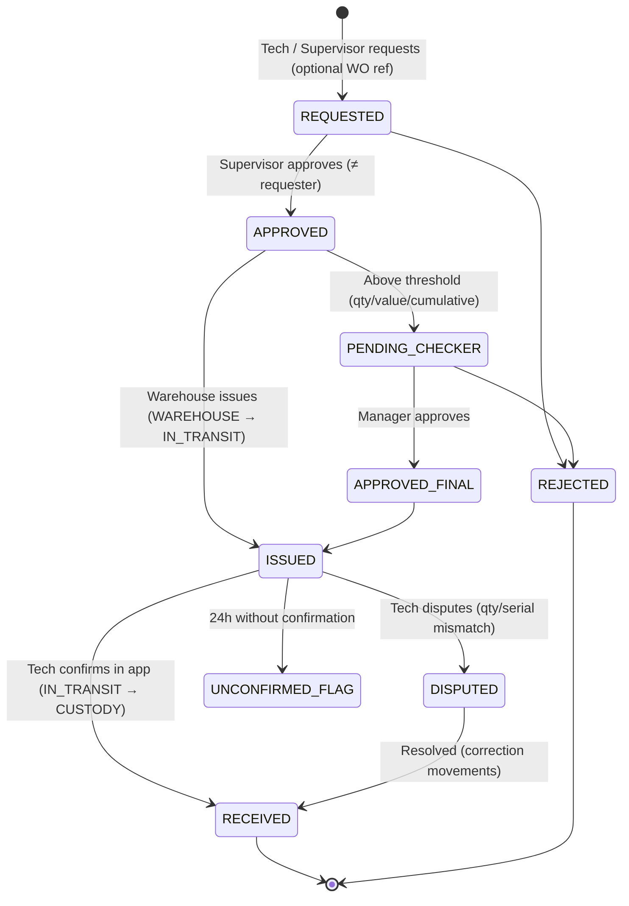

# 06 — المخزون

## 6.1 المبدأ: دفتر أستاذ حركات غير قابل للتعديل (Stock Ledger)

**لا يوجد حقل "الكمية" يُعدَّل.** الرصيد = مجموع الحركات.

كل حركة تنقل كمية من **موقع مخزني** إلى آخر (Double-entry):

```
StockMovement
  id, type, item_id, quantity (> 0), unit
  from_location  →  to_location
  serial_numbers[]      (للأصناف المرقمة)
  work_order_id?        (للاستهلاك)
  asset_id?             (للاستهلاك)
  request_id?           (للصرف)
  performed_by, confirmed_by?
  reversal_of?          (للتصحيح)
  occurred_at, recorded_at
```

**المواقع المخزنية (Stock Locations):**

| النوع | مثال | ملاحظة |
|---|---|---|
| `SUPPLIER` | (افتراضي) | مصدر الاستلام |
| `WAREHOUSE` | المخزن المركزي | |
| `CUSTODY` | عهدة الفني #17 (مركبته) | موقع لكل فني/مركبة |
| `IN_TRANSIT` | صرف بانتظار تأكيد الاستلام | يمنع "صرفت له" دون "استلمت" |
| `CONSUMED` | (افتراضي) مستهلك على أمر عمل/أصل | نهاية حياة القطعة الجديدة |
| `CORE_BIN` | صندوق القطع التالفة المستردة | بانتظار إتلاف/إرجاع للمورد (ضمان) |
| `SALVAGE` | مكونات مستردة من أصول مشطوبة | قابلة لإعادة الاستخدام بعد فحص |
| `ADJUSTMENT` | (افتراضي) فروقات الجرد | كل حركة إليه/منه = Four-Eyes |
| `SCRAP` | (افتراضي) إتلاف | |

**لماذا هذا النموذج؟**
- لا تعديل صامت ممكن — حتى "تصحيح خطأ إدخال" هو حركة عكسية مرئية.
- الرصيد في أي لحظة تاريخية قابل للحساب (تدقيق "كم كان في عهدة الفني 17 يوم 3 مارس؟").
- الاتساق قابل للتحقق آليًا: `Σ الداخل − Σ الخارج = الرصيد` لكل موقع؛ يُفحص يوميًا.
- للأداء: جدول أرصدة مادّي (Materialized balance) يُحدَّث في نفس المعاملة، ويُطابق يوميًا مع الحركات.

## 6.2 الأصناف

```
InventoryItem
  sku: LED-DRV-60W
  name_ar / name_en
  unit: EA | M | KG ...
  tracking: NONE | SERIAL
  core_return_required: bool
  standard_cost (مُصدَّر، تغييره Four-Eyes)
  compatible_asset_models[]   (اختياري)
  reorder_point, safety_stock, lead_time_days
```

**MVP للإنارة — قائمة أصناف قصيرة فعلية:** LED Module، Driver، Photocell، فيوز، كابل (م)، ترمينال، كشاف كامل، باب عمود. (10–25 صنفًا تكفي لإثبات المسار.)

## 6.3 التدفقات

### (أ) الاستلام من المورد (Receipt)

```
Warehouse Officer يسجل الاستلام (صنف، كمية، أرقام تسلسلية، مرجع أمر الشراء/الفاتورة، صورة إذن التسليم)
  → Procurement Officer يؤكد (Checker)  → SUPPLIER → WAREHOUSE
```
في MVP قد يكون الاستلام بسيطًا (الرصيد الافتتاحي + استلامات يدوية). التكامل مع المشتريات Phase 4.

### (ب) طلب وصرف للعهدة



**التسليم ثنائي الطرف** هو قلب ضبط المخزن: أمين المخزن يسجل الصرف، **والفني يؤكد الاستلام في تطبيقه** (بما فيها الأرقام التسلسلية للقطع المرقمة — يمسحها أو يؤكدها). بدون تأكيد، الكمية في `IN_TRANSIT` لا تُحسب في عهدة الفني ولا تُعتبر خرجت من مسؤولية المخزن.

**طلب مسبق مقابل حد العهدة:** كل فني له **حد عهدة** لكل صنف (مثلًا ≤ 4 Drivers). الطلب الذي يتجاوز الحد يتطلب Checker. يمنع تكديس العهدة.

### (ج) الاستهلاك على أمر عمل

```
Tech (أثناء IN_PROGRESS): يختار من عهدته → CUSTODY(tech) → CONSUMED
  + work_order_id + asset_id + serial_numbers (للمرقم)
```
- **يعمل دون اتصال.** الخادم يتحقق عند المزامنة.
- إذا تجاوز الاستهلاك رصيد العهدة المعروف للخادم → **لا يُرفض** (الواقع الميداني أهم) لكن ← `CONSUMPTION_EXCEEDS_CUSTODY` Flag عالي الأولوية ويرفع مستوى مخاطرة أمر العمل.
- **الرقم التسلسلي** للقطعة المركبة يجب أن يكون في عهدة الفني. رقم غير معروف ← Flag.

### (د) Core Return — إرجاع القطعة التالفة

```
عند استهلاك صنف core_return_required:
  الفني يُعلن: "القطعة القديمة معي" (+ صورة لها + رقمها التسلسلي إن وُجد)
            أو  "غير قابلة للاسترداد" (سبب: تحطمت/سُرقت/احترقت كليًا + صورة)
  → التزام مفتوح (Core Return Obligation) على الفني
  → أمين المخزن يستلم القطعة فعليًا → CORE_BIN (يمسح/يطابق الرقم التسلسلي إن وُجد)
  → الالتزام يُغلق
التزام مفتوح > 7 أيام ← MISSING_CORE_RETURN Flag
نسبة "غير قابلة للاسترداد" مرتفعة لفني ← إشارة
```

**مطابقة الرقم التسلسلي:** للقطع المرقمة، النظام يعرف أي رقم تسلسلي **مركب حاليًا في هذا الأصل** (`serial_units.installed_asset_id` — من الاستهلاك السابق أو الجرد الأساسي). القطعة التالفة المسلّمة يجب أن تحمل ذلك الرقم؛ قطعة تالفة من عمود آخر لن تطابق ← Flag. (عند الجرد الأساسي قد يكون الرقم مجهولًا — تُقبل أول مرة وتُسجل.)

**فائدة إضافية:** القطع في `CORE_BIN` ذات الضمان الساري تُجمع لإرجاعها للمورد (قيمة مالية مباشرة).

### (هـ) الإرجاع من العهدة

`CUSTODY → IN_TRANSIT → WAREHOUSE` — الفني يعلن الإرجاع، وأمين المخزن يؤكد الاستلام (ثنائي الطرف بالعكس).

### (و) الجرد (Cycle Count)

| النوع | من ينفذ | التكرار |
|---|---|---|
| جرد المخزن الدوري | أمين المخزن + شاهد (مدقق/مندوب) | شهري لأصناف A، ربعي لغيرها |
| **جرد العهدة المفاجئ** | مفتش أو مدقق (ليس أمين المخزن) | عينة عشوائية من الفنيين أسبوعيًا |
| جرد افتتاحي | فريق مشترك | **مرة واحدة قبل الإطلاق — شرط لقياس النجاح** |

```
Count Session: يُسجل المعدود فعليًا (مع صور للأصناف المرقمة)
  → النظام يحسب الفرق مقابل الرصيد الدفتري "في لحظة الجرد"
  → لا فرق: إغلاق
  → فرق: طلب تسوية (Adjustment Request) = Four-Eyes
       الطالب ≠ المعتمد، وأمين المخزن لا يعتمد تسوية مخزنه
       التسوية السالبة فوق عتبة → إشعار المدقق
```

**الجرد "الأعمى":** شاشة الجرد **لا تعرض الرصيد الدفتري** للعادّ. يعد ويُدخل، ثم يُقارن النظام. (يمنع "العد حتى الرقم المتوقع".)

## 6.4 قواعد الاتساق والإشارات (Inventory Flags)

| الرمز | الشرط | الخطورة |
|---|---|---|
| `CONSUMPTION_EXCEEDS_CUSTODY` | استهلاك > رصيد العهدة | عالية |
| `UNKNOWN_SERIAL` | رقم تسلسلي مستهلك غير موجود في العهدة | عالية |
| `ISSUE_UNCONFIRMED` | صرف غير مؤكد > 24 ساعة | متوسطة |
| `MISSING_CORE_RETURN` | التزام إرجاع مفتوح > 7 أيام | متوسطة |
| `CUSTODY_AGING` | صنف في العهدة > 60 يومًا دون حركة | منخفضة |
| `CUSTODY_OVER_LIMIT` | رصيد العهدة > الحد | متوسطة |
| `CONSUMPTION_OUTLIER` | استهلاك الصنف لنوع التشخيص > P95 للأقران (عينة ≥ 20) | منخفضة (إشارة مراجعة) |
| `WO_MATERIAL_WITHOUT_EXPECTATION` | صنف لا يتوقعه التشخيص | منخفضة |
| `ADJUSTMENT_PATTERN` | تسويات سالبة متكررة لنفس الصنف/المخزن | متوسطة |
| `SPLIT_ISSUE` | صرف متكرر يتجاوز العتبة تراكميًا | متوسطة |

**لاحظ:** هذه الإشارات تحل محل قاعدتي الفكرة الأصلية ("مواد في أمر عمل بلا صرف" و"صرف بلا استهلاك") بصيغة تتوافق مع نموذج العهدة: المطابقة تتم **بين العهدة والاستهلاك** لا بين أمر العمل والصرف.

## 6.5 التنبؤ (Phase 2)

```
needed_30d  = avg_monthly_consumption (آخر 3–6 أشهر، مرجح)
            + Σ expected_consumption(open WOs by diagnosis)
available   = warehouse + Σ custody − reserved
reorder_warning if available < needed_30d × (lead_time/30) + safety_stock
```
في MVP: فقط `stock < reorder_point` (ثابت يُهيأ يدويًا). التنبؤ يحتاج بيانات استهلاك حقيقية لعدة أشهر.

## 6.6 ما ليس في النطاق

- المشتريات (أوامر شراء، عروض أسعار، موردون) — ERP.
- التقييم المحاسبي للمخزون (FIFO/متوسط مرجح) — ERP. نستخدم Standard Cost للتحليل التشغيلي فقط.
- تعدد المخازن المعقد والتحويلات بينها — Phase 2 (النموذج يدعمه؛ الواجهة لا).
