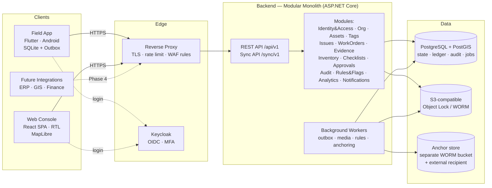

# 08 — المعمارية، حدود الـ API، هيكل المستودع، والقرارات التقنية

## 8.1 النظرة العامة



**وحدة نشر واحدة للـ Backend** (عملية API + عملية Workers من نفس الكود)، **قاعدة بيانات واحدة**، **تخزين كائنات واحد**، **مزود هوية واحد**. هذا كل شيء في MVP.

## 8.2 لماذا Modular Monolith (ومتى نفصل)

**الآن:** فريق صغير، نطاق يتغير بسرعة، معاملات تمتد عبر وحدات (إغلاق أمر عمل يلمس المخزون والأصل والتدقيق في **معاملة واحدة** — وهذا بالضبط ما يضمن النزاهة). الـ Microservices هنا ستحوّل معاملة واحدة إلى Saga موزعة، وتجعل "لا تغيير بلا تدقيق" أصعب بكثير.

**قواعد الوحدات (تُفرض بالاختبارات المعمارية — ArchUnit/NetArchTest):**
1. كل وحدة تملك جداولها (Schema منفصل في PostgreSQL: `assets.*`, `workorders.*`, `inventory.*` ...). **لا وحدة تقرأ جداول وحدة أخرى مباشرة.**
2. التواصل المتزامن عبر واجهات عامة (`Contracts`) للوحدة فقط.
3. التواصل غير المتزامن عبر أحداث نطاق (Domain Events) من خلال **Transactional Outbox** في نفس القاعدة.
4. وحدة `Audit` تُستدعى من كل الوحدات عبر واجهة واحدة داخل نفس المعاملة.

**معايير الفصل لاحقًا (أي منها):** وحدة تحتاج تحجيمًا مستقلًا فعليًا (مثلًا معالجة الوسائط)، أو فريق مستقل يملكها، أو متطلبات عزل أمني/تنظيمي. المرشح الأول المرجح: **معالجة الوسائط** (Media processing)، ثم **التحليلات**.

## 8.3 حدود الوحدات (Bounded Contexts) والـ API

| الوحدة | تملك | أمثلة Endpoints (REST، JSON) |
|---|---|---|
| **Identity & Access** | المستخدمون، الأدوار، الإسناد، الأجهزة، Break Glass | `GET /me` · `POST /devices/register` · `POST /role-assignments` · `POST /break-glass` |
| **Organization** | الجهات، الأقسام، الفرق، المناطق (مضلعات)، المخازن | `GET /org/units` · `GET /zones` |
| **Assets** | الأنواع، الأصول، الإصدارات، التسجيل، التحقق، الشطب، المشاريع | `POST /asset-registrations` · `POST /asset-registrations/{id}/submit` · `POST /asset-registrations/{id}/approve` · `GET /assets?bbox=&type=&status=` · `GET /assets/{id}/history` |
| **Tags** | الملصقات، الدفعات، العهدة، الربط | `POST /tag-batches` · `GET /t/{tagCode}` (resolve) · `POST /tags/{id}/void` |
| **Issues** | البلاغات، التأكيدات، جولات التفقد | `POST /issues` · `POST /issues/{id}/confirm` · `POST /inspection-rounds` |
| **WorkOrders** | أوامر العمل، الأحداث، التشخيص، التقديمات، المراجعات، التعديلات | `POST /work-orders` · `POST /work-orders/{id}/assign` · `POST /work-orders/{id}/review` · `GET /work-orders/{id}/evidence-chain` |
| **Evidence** | بيانات الأدلة، الرفع، التحقق، pHash، الوصول الموقع | `POST /evidence/{id}/upload-url` · `GET /evidence/{id}/view-url` |
| **Checklists** | القوالب المُصدَّرة، النتائج | `GET /checklist-templates?assetType=&workType=` |
| **Inventory** | الأصناف، المواقع، الحركات، الطلبات، العهدة، Core Return، الجرد | `POST /stock-requests` · `POST /stock-requests/{id}/issue` · `POST /stock-issues/{id}/confirm-receipt` · `GET /custody/me` · `POST /count-sessions` |
| **Approvals** | طلبات Four-Eyes العامة | `GET /approvals?assignedToMe` · `POST /approvals/{id}/decide` |
| **Audit** | الأحداث، السلسلة، التثبيت، التحقق | `GET /audit/events?entity=` · `POST /audit/verify-chain` |
| **Rules & Flags** | تعريف القواعد، التنفيذ، الإشارات، حالات التدقيق العشوائي | `GET /flags` · `POST /flags/{id}/decide` · `GET /audit-cases` |
| **Analytics** | Read models للوحات، مقاييس | `GET /dashboards/manager` · `GET /assets/{id}/metrics` |
| **Sync** | استقبال دفعات الأوامر من الأجهزة، التغييرات للأجهزة | `POST /sync/v1/push` · `GET /sync/v1/pull?since=` |
| **Notifications** | إشعارات داخل التطبيق، (لاحقًا) SMS/Push | `GET /notifications` |

**مبادئ الـ API:**
- **أوامر (Commands) لا تحديثات عامة.** لا `PATCH /work-orders/{id}` حر. بل `POST /work-orders/{id}/submit`، `.../review`. كل Endpoint = انتقال موثق في آلة الحالات. هذا يجعل الصلاحيات والتدقيق دقيقين.
- **Idempotency-Key** إلزامي لكل أمر كتابة (الأجهزة تعيد الإرسال).
- **Optimistic concurrency:** كل كيان له `version`؛ الأوامر تحمل `expected_version` حين يلزم.
- **OpenAPI** مولّد من الكود ومنشور؛ عملاء TypeScript وDart مولّدون منه.
- **الإصدار في المسار** (`/api/v1`). واجهات التكامل الخارجية لاحقًا منفصلة (`/integration/v1`) بمصادقة Client Credentials ونطاقات محدودة.
- **الأخطاء** بصيغة RFC 9457 (Problem Details) برموز أعمال ثابتة (`WO_EVIDENCE_MISSING`, `SOD_VIOLATION`...) ورسائل عربية/إنجليزية.

## 8.4 أنماط داخلية

| النمط | أين | لماذا |
|---|---|---|
| State machine صريحة | WorkOrder, AssetRegistration, StockRequest, Approval | القلب المنطقي؛ مختبرة بالكامل |
| Transactional Outbox | كل الوحدات | أحداث موثوقة دون Message broker خارجي |
| Append-only event tables | `work_order_events`, `stock_movements`, `audit_events` | التاريخ الكامل والنزاهة |
| Read models (Projections) | Analytics | لوحات سريعة دون استعلامات ثقيلة على الجداول التشغيلية |
| **ليس Event Sourcing كاملًا** | — | الحالة الحالية في جداول عادية + جداول أحداث مرافقة. Event Sourcing الكامل يضاعف التعقيد (إعادة البناء، تطور الأحداث، التقارير) دون فائدة إضافية تبرره هنا؛ جدول الأحداث + التدقيق يعطيان 90% من الفائدة. |
| CQRS خفيف | القراءات الثقيلة (لوحات، خرائط) | من نفس القاعدة؛ لا قاعدة قراءة منفصلة في MVP |

## 8.5 القرارات التقنية مع الأسباب

> القاعدة: كل قرار يُسجل كـ **ADR** في `docs/adr/` عند بدء Phase 0. الجدول أدناه هو المقترح.

### Backend: **ASP.NET Core (.NET 10 LTS, C#)** — موصى به

| المعيار | .NET | NestJS (TypeScript) | FastAPI (Python) |
|---|---|---|---|
| نمذجة نطاق غنية وState machines بأمان أنواع | ممتاز | جيد | متوسط |
| معاملات ORM ناضجة (EF Core) + PostGIS | ممتاز (NetTopologySuite) | جيد (TypeORM/Prisma — دعم PostGIS أضعف) | جيد (SQLAlchemy + GeoAlchemy) |
| أداء على خوادم متواضعة | ممتاز | جيد | متوسط |
| دعم طويل الأمد (LTS) وأمن | ممتاز (3 سنوات LTS، Microsoft) | يعتمد على منظومة npm (سطح هجوم Supply-chain أكبر) | جيد |
| شيوع في تقنية المعلومات الحكومية في المنطقة (توظيف/تسليم/صيانة) | عالٍ جدًا | متوسط | متوسط |
| مشاركة اللغة مع الويب | لا | نعم | لا |
| التحليلات والبيانات | جيد | ضعيف | ممتاز |

**القرار:** .NET لأن هذا نظام حكومي طويل العمر يعتمد على **صحة المعاملات، أمان الأنواع في آلات الحالات، وسهولة التسليم لفريق حكومي لاحقًا**. ميزة NestJS الأساسية (لغة واحدة مع React) لا تعوض ذلك، خاصة أن الموبايل بـ Dart على أي حال.
**متى نختار NestJS بدلًا منه:** إذا كان الفريق المتاح فعليًا خبرته TypeScript فقط ولا يمكن تغييره. **خبرة الفريق تغلب هذا الجدول** — هذا سؤال مفتوح.
FastAPI يبقى مرشحًا **لوحدة تحليلات منفصلة** في Phase 5 (نماذج تنبؤية) — لا للقلب.

### Database: **PostgreSQL 17 + PostGIS** — مؤكد

- المعاملات، JSONB للسمات المرنة لكل نوع أصل، PostGIS للاستعلامات المكانية (قرب، مضلعات المناطق، Clustering)، Partitioning لجداول التدقيق، `pgaudit`، ناضج ومفتوح المصدر ولا ترخيص (مهم حكوميًا).
- **لا قاعدة NoSQL ولا قاعدة Time-series منفصلة** في أي مرحلة قريبة.

### Jobs/Queue: **PostgreSQL نفسه** (Outbox + جدول مهام) — لا Redis في MVP

- Redis يضيف مكونًا يجب تشغيله ونسخه ومراقبته وتأمينه. حجم المهام في MVP (معالجة صور، قواعد ليلية، تثبيت يومي) صغير جدًا.
- التنفيذ: Outbox + Worker مستضاف (`BackgroundService`) + مكتبة جدولة بتخزين PostgreSQL (Hangfire أو Quartz.NET أو TickerQ — يُحسم في ADR). `SELECT ... FOR UPDATE SKIP LOCKED` نمط موثوق.
- **متى نضيف Redis:** Rate limiting موزع عبر عدة نسخ API، أو Cache ساخن بحمل حقيقي.

### Object Storage: **S3-compatible مع Object Lock**

- يعمل مع أي مزود: سحابة حكومية، Ceph RGW، MinIO، SeaweedFS.
- **ملاحظة شراء:** راجعوا حالة ترخيص ودعم المنتج المختار وقت الشراء (بعض المنتجات غيّرت نماذج توزيع نسخها المجتمعية مؤخرًا). الكود يعتمد على واجهة S3 فقط فالبديل سهل.
- Object Lock (Compliance mode) لـ Bucket الأدلة إلزامي.

### Identity: **Keycloak**

- OIDC/OAuth2، MFA (TOTP/WebAuthn)، سياسات كلمات المرور، قفل الحساب، **اتحاد مع هوية وطنية (SAML/OIDC) لاحقًا دون تغيير التطبيق**، تشغيل محلي بلا ترخيص.
- تكلفته: مكون إضافي للتشغيل. البديل (ASP.NET Identity داخليًا) أبسط، لكن سيُعاد بناؤه عند أول طلب ربط بالهوية الوطنية أو SSO حكومي — وهو شبه مؤكد.
- **الصلاحيات تبقى في تطبيقنا** (Keycloak للهوية والمصادقة فقط). منطق RBAC+SoD معقد ومرتبط بالنطاق ولا مكان له في مزود الهوية.

### Web: **React + TypeScript + Vite (SPA)** — لا Next.js في MVP

- لوحة إدارية داخلية خلف تسجيل دخول: لا فائدة من SSR/SEO. Next.js يضيف خادم Node للتشغيل والتأمين.
- مكتبات: TanStack Query (بيانات)، React Router، مكتبة مكونات تدعم RTL جيدًا (Mantine أو MUI — تُحسم بتجربة RTL فعلية)، react-i18next، **MapLibre GL JS**.
- **Next.js مرشح لاحقًا لبوابة الشفافية العامة** (Phase 4+) حيث SEO وSSR مهمان.

### الخرائط: **MapLibre GL + بلاطات مستضافة ذاتيًا أو من مزود محلي**

- لا Google Maps: تكلفة، شروط استخدام، سيادة بيانات، واعتماد على خدمة أجنبية.
- الخيار: بلاطات OpenStreetMap متجهية (PMTiles مستضافة كملف ثابت واحد — تشغيل بسيط جدًا) أو خدمة خرائط الجهة الحكومية إن وجدت.
- عرض آلاف الأصول: Clustering في العميل + استعلامات `bbox` مع PostGIS؛ ولاحقًا بلاطات متجهية للأصول (`ST_AsMVT`) إذا تجاوزنا ~50 ألف نقطة معروضة.

### Mobile: **Flutter** (Android أولًا)

| المعيار | Flutter | React Native | Native Android (Kotlin) |
|---|---|---|---|
| أداء على هواتف ضعيفة | جيد جدًا (رسم ثابت) | جيد (مع البنية الجديدة) | ممتاز |
| RTL والعربية | ممتاز | جيد | ممتاز |
| قاعدة محلية + Offline | ممتاز (drift/SQLite، SQLCipher) | جيد (WatermelonDB/op-sqlite) | ممتاز (Room) |
| الوصول للكاميرا/Keystore/Integrity/Mock detection | عبر Plugins + Platform channels | عبر Native modules | مباشر |
| iOS لاحقًا إن لزم | نفس الكود | نفس الكود | إعادة كتابة |
| حجم الفريق المطلوب | واحد | واحد | واحد (Android فقط) |

**القرار:** Flutter — توازن بين الأداء على الأجهزة الضعيفة، جودة RTL، ونضج أدوات العمل دون اتصال، مع إبقاء خيار iOS. الأجزاء الحساسة (كاميرا مقيدة، Keystore، Integrity) تُكتب كـ Platform channels بـ Kotlin عند الحاجة.
**متى Native Android:** إذا كانت الجهة ستوفر أجهزة Android مدارة فقط **ولا نية لـ iOS أبدًا**، والفريق Kotlin — خيار ممتاز أيضًا.

### المراقبة (Observability)

OpenTelemetry (traces/metrics/logs) → Prometheus + Grafana + Loki (مستضافة ذاتيًا). سجلات منظمة JSON، **بلا بيانات شخصية في السجلات التقنية** (قاعدة مفروضة بمراجعة الكود).

### النشر

Docker images، **Docker Compose على VMs للتجربة**، Kubernetes فقط إذا كانت بيئة الجهة تفرضه أو تجاوزنا عدة بلديات. التفاصيل في [13](13-security-privacy-deployment.md).

## 8.6 هيكل المستودع (Monorepo)

```
/
├── README.md
├── docs/
│   ├── spec/                     ← هذه الوثيقة
│   ├── adr/                      ← 0001-backend-dotnet.md, 0002-no-redis-mvp.md ...
│   ├── runbooks/                 ← تشغيل، نسخ احتياطي، استعادة، حوادث، Break Glass
│   └── api/                      ← OpenAPI المولّد (يُنشر)
├── backend/
│   ├── Mfop.sln
│   ├── src/
│   │   ├── Mfop.Host.Api/             ← نقطة الدخول HTTP، التهيئة، Middleware
│   │   ├── Mfop.Host.Worker/          ← نقطة دخول العمال الخلفيين
│   │   ├── BuildingBlocks/
│   │   │   ├── Mfop.SharedKernel/     ← Result, Errors, Clock, Ids, StateMachine base
│   │   │   ├── Mfop.Infrastructure/   ← EF base, Outbox, Idempotency, S3, OTel
│   │   │   └── Mfop.Authorization/    ← IAuthorizer, SoD rules, Scope resolution
│   │   └── Modules/
│   │       ├── Identity/   { Domain, Application, Infrastructure, Api, Contracts }
│   │       ├── Organization/
│   │       ├── Assets/
│   │       ├── Tags/
│   │       ├── Issues/
│   │       ├── WorkOrders/
│   │       ├── Evidence/
│   │       ├── Checklists/
│   │       ├── Inventory/
│   │       ├── Approvals/
│   │       ├── Audit/
│   │       ├── Rules/
│   │       ├── Analytics/
│   │       ├── Sync/
│   │       └── Notifications/
│   └── tests/
│       ├── Architecture.Tests/        ← حدود الوحدات
│       ├── Modules.*.UnitTests/
│       ├── Integration.Tests/         ← Testcontainers (PostgreSQL+PostGIS, S3)
│       ├── Authorization.Tests/       ← مصفوفة الصلاحيات كاملة (مولدة)
│       └── AbuseCases.Tests/          ← AC-01 … AC-33
├── web/
│   ├── src/
│   │   ├── app/ (routing, providers, i18n)
│   │   ├── features/ (assets, work-orders, approvals, inventory, audit, dashboards, admin)
│   │   ├── shared/ (api-client [generated], ui, map)
│   │   └── locales/ (ar, en)
│   └── e2e/ (Playwright)
├── mobile/
│   ├── lib/
│   │   ├── core/ (db [drift], sync engine, outbox, crypto, device, clock, i18n)
│   │   ├── features/ (tasks, work_order_flow, asset_register, custody, inspection_round)
│   │   └── shared/ (api [generated], widgets, camera)
│   ├── android/ (platform channels: camera guard, keystore, integrity)
│   └── integration_test/
├── deploy/
│   ├── compose/ (docker-compose.yml, .env.example — بلا أسرار)
│   ├── keycloak/ (realm export — بلا أسرار)
│   ├── postgres/ (init, roles, pgaudit config)
│   ├── observability/
│   └── backup/ (pgBackRest config, restore drill script)
├── tools/
│   ├── seed/ (أنواع الإنارة، قوالب الفحص، أصناف، أدوار)
│   ├── tag-printing/ (توليد دفعات QR للطباعة PDF)
│   └── chain-verifier/ (أداة مستقلة للمدقق للتحقق من سلسلة التدقيق)
└── .github/workflows/ (ci-backend, ci-web, ci-mobile, security-scan)
```

**`chain-verifier` أداة مستقلة عمدًا:** المدقق يجب أن يستطيع التحقق من السلسلة **دون الثقة في التطبيق نفسه** — يقرأ تصديرًا للأحداث والتثبيت الخارجي ويعيد الحساب.
