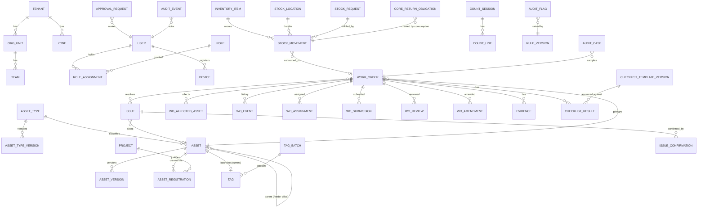

# 09 — نموذج النطاق والبيانات

## 9.1 مبادئ عامة

- **المعرفات:** UUIDv7 (مرتبة زمنيًا، تُولَّد على الجهاز دون تعارض — ضرورية للعمل دون اتصال) + رموز مقروءة منفصلة (`SL-003821`, `WO-2026-008842`).
- **Multi-tenant من اليوم الأول:** `tenant_id` في كل جدول تشغيلي + Row-Level Security في PostgreSQL كخط دفاع ثانٍ. حتى لو نُشر النظام لبلدية واحدة، التصميم لا يمنع التوسع لبلديات متعددة أو فصلها لاحقًا.
- **التزامن المتفائل:** `version INT` في كل كيان قابل للتغيير.
- **الوقت:** `timestamptz` بتوقيت UTC في القاعدة؛ العرض بتوقيت الجهة.
- **الحذف:** لا `DELETE` تشغيلي (انظر [04](04-asset-lifecycle-and-verification.md#410-سياسة-عدم-الحذف)).
- **السمات المرنة لكل نوع أصل:** `attributes JSONB` مُتحقق منها بـ JSON Schema مُصدَّر لكل نوع (`asset_type_versions.schema`). الحقول المشتركة والقابلة للاستعلام (الموقع، الحالة، الطراز، التركيب، الضمان) أعمدة حقيقية.

## 9.2 خريطة الكيانات حسب الوحدة



## 9.3 الجداول الأساسية (مختصرة — الأعمدة الجوهرية فقط)

### Identity & Organization

```
tenants(id, name, default_locale, timezone, settings jsonb)
org_units(id, tenant_id, parent_id, kind[MUNICIPALITY|DEPARTMENT|SECTION|CONTRACTOR], name_ar, name_en)
teams(id, org_unit_id, name, active)
zones(id, tenant_id, name, geom geometry(MultiPolygon,4326), baseline_status[OPEN|CLOSED], baseline_closed_at, baseline_closed_by)
users(id, tenant_id, idp_subject, display_name, employee_no, org_unit_id, team_id, status[ACTIVE|DISABLED], labor_rate_class)
roles(code PK, name_ar, name_en, sensitive bool)            -- seeded
role_permissions(role_code, permission)                     -- seeded
role_assignments(id, user_id, role_code, scope_type[TENANT|ORG_UNIT|ZONE|TEAM|WAREHOUSE], scope_id,
                 valid_from, valid_to, granted_by, approval_request_id, revoked_at, revoked_by)
sod_incompatibilities(role_a, role_b)                       -- seeded
devices(id, user_id, platform, model, os_version, app_version, public_key?, status[ACTIVE|REVOKED|LOST],
        registered_at, last_seen_at, revoked_at, revoked_by, revoke_reason)
break_glass_sessions(id, user_id, reason_code, reason_text, scope jsonb, started_at, expires_at, ended_at, reviewed_by, review_outcome)
```

### Assets & Tags

```
asset_types(id, code[LIGHT_POINT|FEEDER_PILLAR|...], category[POINT|LINEAR|MOBILE|FACILITY], code_prefix)
asset_type_versions(id, asset_type_id, version, attribute_schema jsonb, material_attributes text[], effective_from)
projects(id, tenant_id, ref_no, title, expected_asset_count, status)
assets(id, tenant_id, asset_type_id, asset_code UNIQUE NULL, lifecycle_state, operational_status,
       location geometry(Point,4326), location_accuracy_m, zone_id, parent_asset_id, circuit_ref,
       make, model, installed_on, installed_on_precision[EXACT|YEAR|UNKNOWN], supplier, warranty_until,
       replacement_cost_estimate, attributes jsonb, current_tag_id, current_version, version)
asset_versions(id, asset_id, version_no, snapshot jsonb, snapshot_hash, approved_by, approved_at, change_reason)
asset_registrations(id, asset_id, registrar_id, reason[BASELINE_SURVEY|NEW_INSTALLATION|REPLACEMENT|RELOCATION|MISSED_IN_SURVEY],
       project_id, replaces_asset_id, state, submitted_at, field_check_required, field_check_reason,
       decided_by, decided_at, decision_reason)
asset_field_verifications(id, registration_id|asset_id, inspector_id, outcome[CONFIRMED|MISMATCH|NOT_FOUND], evidence_id, at)
asset_status_events(id, asset_id, from_status, to_status, cause_type[WO|ISSUE|EXTERNAL], cause_id, at)   -- append-only
tag_batches(id, tenant_id, prefix, count, printed_at, printed_by)
tags(id, batch_id, tag_code UNIQUE, check_code, status, custodian_user_id, bound_asset_id, bound_at)
tag_events(id, tag_id, event[ISSUED|BOUND|VOIDED|DAMAGED|RETURNED], actor, reason, evidence_id, at)  -- append-only
```

### Issues & Work Orders

```
issues(id, tenant_id, source, category_code, asset_id?, location geometry(Point), description,
       reported_by, reported_at, state, priority_suggestion, inspection_round_id?)
issue_confirmations(id, issue_id, confirmed_by, evidence_id?, at)
inspection_rounds(id, zone_id, inspector_id, kind[NIGHT_LIGHTING|GENERAL], started_at, ended_at)
work_orders(id, tenant_id, code, type, priority, state, primary_asset_id, work_template_code,
       checklist_template_version_id, risk_tier, sla_due_at, created_by, rework_of_wo_id,
       diagnosis_code, root_cause_code, closed_at, seal_hash, amended_count, version)
work_order_issues(work_order_id, issue_id)
wo_affected_assets(work_order_id, asset_id, impact[OUTAGE|DEGRADED])
wo_assignments(id, work_order_id, user_id, role[LEAD|ASSIST], assigned_by, assigned_at, unassigned_at, reason)
wo_events(id, work_order_id, seq, type, actor_id, device_id, command_id, data jsonb,
          device_time, elapsed_ms, server_time, estimated_time)                          -- append-only
wo_arrivals(id, work_order_id, user_id, tag_scanned bool, manual_code_reason, gps, accuracy_m, is_mock,
            presence_score, presence_breakdown jsonb, estimated_time)
wo_submissions(id, work_order_id, submission_no, submitted_by, report jsonb, submitted_at, payload_hash)
wo_reviews(id, work_order_id, submission_id, reviewer_id, decision[APPROVE|RETURN|ESCALATE], reason,
           review_started_at, decided_at)       -- review_started_at يقيس زمن المراجعة الفعلي
wo_amendments(id, work_order_id, approval_request_id, changes jsonb, prev_seal_hash, new_seal_hash)
checklist_templates(id, asset_type_id, work_template_code)
checklist_template_versions(id, template_id, version, items jsonb, published_by, published_at)
checklist_results(id, work_order_id, template_version_id, answers jsonb, test_method, completed_at)
```

### Evidence

```
evidence(id, tenant_id, owner_type, owner_id, kind, sha256, phash, mime, size_bytes, storage_key,
         captured_by, device_id, device_time, elapsed_ms, estimated_time, clock_skew_ms,
         gps geometry(Point), accuracy_m, is_mock, status[PENDING_UPLOAD|HASH_OK|HASH_MISMATCH],
         superseded_by, supersede_reason, received_at, verified_at)
evidence_similarity(evidence_id, similar_evidence_id, hamming_distance, detected_at)
```

### Inventory

```
inventory_items(id, tenant_id, sku, name_ar, name_en, unit, tracking[NONE|SERIAL], core_return_required,
                reorder_point, safety_stock, lead_time_days)
item_costs(id, item_id, standard_cost, currency, effective_from, approval_request_id)    -- مُصدَّر
stock_locations(id, tenant_id, kind, name, warehouse_id?, custodian_user_id?)
stock_movements(id, tenant_id, type[RECEIPT|ISSUE|RECEIVE|CONSUME|RETURN|RETURN_RECEIVE|CORE_RETURN|
                SALVAGE|ADJUSTMENT|TRANSFER|SCRAP|REVERSAL],
                item_id, quantity numeric, from_location_id, to_location_id, serials text[],
                work_order_id, asset_id, request_id, count_session_id, reversal_of,
                performed_by, command_id, occurred_at_estimated, recorded_at)          -- append-only
stock_balances(location_id, item_id, quantity, updated_at)          -- materialized، يُطابق يوميًا
serial_units(serial, item_id, current_location_id, status, installed_asset_id)
stock_requests(id, requester_id, for_user_id, work_order_id?, state, lines jsonb, approved_by, ...)
custody_limits(user_id|team_id, item_id, max_qty)
core_return_obligations(id, consume_movement_id, user_id, item_id, serial, declared[WITH_ME|UNRECOVERABLE],
                        declaration_evidence_id, state[OPEN|RECEIVED|WAIVED], received_movement_id, due_at)
count_sessions(id, location_id, kind[PERIODIC|SURPRISE|OPENING], counter_id, witness_id, started_at, closed_at)
count_lines(id, session_id, item_id, counted_qty, serials_counted text[], book_qty_at_count, variance)
```

### Approvals, Audit, Rules

```
approval_requests(id, tenant_id, type, subject_type, subject_id, subject_version, proposed_change jsonb,
                  proposed_hash, maker_id, maker_reason, checker_policy jsonb, state, checker_id,
                  decided_at, decision_reason, expires_at)
audit_events(seq, tenant_id, event_id, occurred_at, actor_user_id, actor_role, break_glass_session_id,
             device_id, action, entity_type, entity_id, entity_version, changes jsonb, reason,
             correlation_id, command_id, payload_hash, prev_hash, hash)      -- partitioned, immutable
audit_checkpoints(id, tenant_id, from_seq, to_seq, last_hash, signature, anchored_at, anchor_locations jsonb)
rules(code, name, description_ar, owner_role)
rule_versions(id, rule_code, version, params jsonb, enabled, effective_from, approval_request_id)
audit_flags(id, tenant_id, rule_version_id, severity, subject_type, subject_id, related_user_ids uuid[],
            explanation jsonb, status, reviewer_id, outcome, decision_reason, employee_response, created_at)
audit_cases(id, tenant_id, work_order_id, sample_batch_id, reason[RANDOM|FLAG|MANUAL], state, outcome,
            auditor_id, field_visit_required, field_visit_evidence_ids uuid[])
audit_sample_batches(id, tenant_id, run_at, population_count, seed_commitment, selected_ids uuid[])
recommendations(id, asset_id, code[FULL_INSPECTION|REPLACEMENT_REVIEW|AREA_INSPECTION|WARRANTY_CLAIM],
                rule_version_id, explanation jsonb, status[OPEN|ACCEPTED|DISMISSED], decided_by)
```

### Sync

```
sync_commands(command_id PK, device_id, user_id, type, payload jsonb, payload_hash,
              device_time, elapsed_ms, boot_id, received_at,
              result[APPLIED|DUPLICATE|REJECTED|QUARANTINED], result_detail jsonb)
sync_quarantine(id, command_id, reason, resolved_by, resolution, resolved_at)
device_clock_samples(device_id, boot_id, server_time, device_time, elapsed_ms, at)
```

## 9.4 ملاحظات على النموذج الأصلي المقترح

| الكيان الأصلي | القرار |
|---|---|
| `AssetStatus` كجدول | ← عمودان (`lifecycle_state`, `operational_status`) + جدول أحداث `asset_status_events` |
| `AssetLocation` منفصل | ← عمود `location` في الأصل + التاريخ في `asset_versions` (الموقع يتغير نادرًا وبموافقة) |
| `AssetPhoto`, `Photo`, `Evidence`, `Attachment` | ← كيان واحد `evidence` بحقل `kind` و`owner_type` (يمنع تكرار منطق الرفع والتحقق 4 مرات) |
| `AssetHistory`, `MaintenanceHistory` | ← **ليست جداول** — هي **عروض (Views/Read models)** مشتقة من `asset_versions` + `asset_status_events` + `work_orders` + `stock_movements`. جدول تاريخ منفصل يُعبأ يدويًا = مصدر حقيقة ثانٍ سيختلف مع الأول. |
| `WorkOrderMaterial` | ← `stock_movements` بنوع `CONSUME` (المادة المستهلكة **هي** الحركة المخزنية — يمنع أن تختلف الروايتان) |
| `InventoryItem` + `Material` | ← كيان واحد `inventory_items` |
| `Alert` | ← `notifications` (تشغيلي) و`audit_flags` (نزاهة) — مفهومان مختلفان |
| `Approval` | ← `approval_requests` عام |
| `OfflineSyncEvent` | ← `sync_commands` |
| **جديد** | `tags`, `tag_batches`, `projects`, `core_return_obligations`, `count_sessions`, `wo_affected_assets`, `wo_arrivals`, `break_glass_sessions`, `audit_checkpoints`, `audit_cases`, `rule_versions` |

## 9.5 الاحتفاظ بالبيانات (مقترح أولي — يُعتمد قانونيًا)

| البيانات | المدة المقترحة | بعدها |
|---|---|---|
| سجل الأصل والصيانة والمخزون والتدقيق | طوال عمر الأصل + مدة الأرشيف الرسمي | أرشفة |
| صور الأدلة الأصلية | 5 سنوات (أو حسب قانون الأرشيف) | أرشفة باردة / حذف موثق |
| إحداثيات الأدلة الدقيقة المرتبطة بالموظف | 3 سنوات | تقريب (≈100م) — الأصل نفسه له موقعه |
| بيانات الأجهزة والجلسات | 1 سنة | حذف |
| الإشارات المغلقة كـ NOT_CONFIRMED | 1 سنة ثم تُفصل عن هوية الموظف | إحصاء فقط |
| سجلات التطبيق التقنية | 90 يومًا | حذف |
